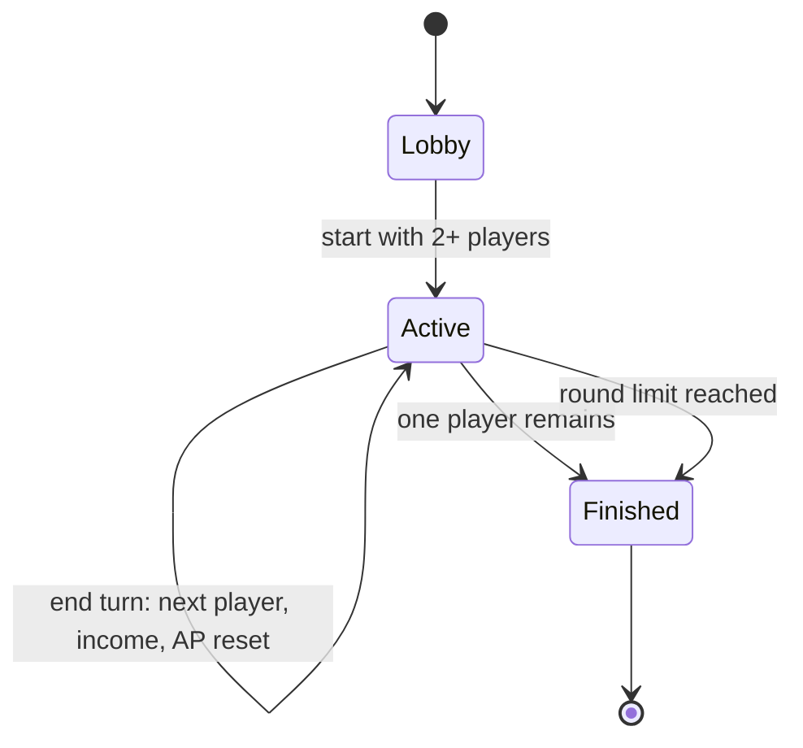

# Game Mechanics

Version tags like **(v5)** mean "introduced in version 5". Version 1 rules are
the complete core; later rules are additive and should not invalidate earlier
tests.

---

## 1. Design pillars

| Pillar | Consequence for the rules |
| --- | --- |
| Every action is a trade-off | Two currencies, AP for tempo and resources for strength, so "expand everywhere" is never free. |
| Board state is legible | Small map, one number per tile, integer arithmetic the player can do in their head. |
| Short games, fast feedback | 15–20 rounds, hard round limit, no infinite stalemates. |
| Deterministic | No dice. Attack outcomes are a function of committed strength, garrison and terrain. |
| The server knows best | Visibility, legality and turn order are computed server-side from Phase 3 onward. |

---

## 2. The board

- Rectangular grid, default **12 × 8 = 96 tiles** (v1). Suggested later sizes:
  `16 × 10` for 4 players, `24 × 16` for the UDP battlefield mode.
- Coordinates are `(x, y)` with `x` = column, `y` = row, origin at the
  **top-left**. Row 0 is the top row. This convention is used in JSON, in the
  renderer, and in test fixtures — one convention, no exceptions.
- Adjacency is **4-directional** (up, down, left, right). No diagonals.
- Unowned land tiles are **neutral** and can be claimed by anyone adjacent.
- Water is never owned and cannot be entered or attacked across.
- Map generation uses a stored `seed` so a game can be regenerated exactly.

### 2.1 Terrain

| Terrain | Char | Passable | Expand cost | Income | Defense | Vision | Notes |
| --- | --- | --- | --- | --- | --- | --- | --- |
| Plains | `.` | yes | 2 | 1 | +0 | 2 | Default; capital tiles are plains. |
| Forest | `f` | yes | 3 | 1 | +1 | 2 | Cheap cover, poor economy. |
| Hills | `h` | yes | 3 | 2 | +2 | 3 | Best income and defense; slow to take. |
| Ruins | `r` | yes | 4 | 0 | +1 | 2 | One-time 15 resources on claim (v8 only). |
| Water | `~` | no | — | 0 | — | 0 | Impassable, blocks adjacency. |

Suggested distribution for a 12 × 8 map: ~12% water, ~20% forest, ~12% hills,
the rest plains. Each capital is guaranteed a ring of two passable, land-only
tiles in every direction so no player is boxed in at spawn.

### 2.2 Tiles

```json
{
  "x": 3,
  "y": 2,
  "terrain": "plains",
  "owner": "alex",
  "strength": 2
}
```

- `owner` is `null` for neutral tiles.
- `strength` is the garrison: 0 for neutral, 1–5 for owned tiles, 1–8 for
  capitals.
- `captured_round` is internal bookkeeping (not shown to clients) and is used
  to block newly captured tiles from acting on the same turn.

---

## 3. Players and setup

| Setting | Value |
| --- | --- |
| Players | 2–4, one capital each |
| Starting resources | 10 |
| Starting capital | strength 3, terrain plains |
| Action points per turn | 3 (unspent AP does **not** carry over) |
| Resources | carry over; no cap in v1 (tuning candidate) |
| Default game length | 20 rounds |

Player identity in v1 is just a display name. Real authentication arrives in
v3; until then the server trusts the name, and the code should say so
explicitly so the Phase 3 security lesson lands.

Capital placement: one per quadrant, e.g. `(2,2)`, `(9,2)`, `(2,5)`, `(9,5)`
on a 12 × 8 board. Validate that capitals are on passable land and at least 5
tiles apart (Manhattan distance).

---

## 4. Turn structure

The game is **sequential**: only one player may act at a time, enforced by the
server.



At the **start of your turn** you:

1. Collect income from all tiles you own (see §5).
2. Reset AP to 3.
3. See the current state.

During your turn you may spend AP and resources in any order. During your turn
you may **end turn** at any time, even with AP remaining.

After the last player in the order ends their turn, the round counter
increments and turn order rotates by one player each round so the same player
does not always move first.

**Turn ownership is enforced.** An action from the wrong player is rejected
with `NOT_YOUR_TURN`. An action after the game ends is rejected with
`GAME_FINISHED`.

### 4.1 Legality checklist

Every action is validated in this order and stops at the first failure. This
ordering is itself a lesson in writing predictable validation layers.

1. Game exists and is `Active`.
2. Request is authenticated (v3+) and the player is in this game.
3. It is this player's turn.
4. The action type is known and its payload is well-formed.
5. The player has enough AP.
6. The player has enough resources.
7. Tile coordinates are in bounds.
8. Source tile is owned by the player.
9. Target tile satisfies the action's adjacency/ownership/terrain rules.
10. Any per-turn flags are clear (`captured_round`, attacked-this-turn limits).

---

## 5. Economy (v1 baseline)

Income is collected at the start of your turn:

```
income = sum(terrain_income[tile.terrain] for tile in owned_tiles)
```

- A capital tile yields **3** (it replaces the base yield, not adds to it).
- Every other owned tile yields its terrain income.
- Water yields nothing and is never owned.
- Income has no randomness and no upkeep in v1.

Example: capital + 2 plains + 1 forest + 1 hills = `3 + 1 + 1 + 1 + 2 = 8`
resources per turn.

### 5.1 Costs at a glance (v1)

| Action | AP | Resources | Target |
| --- | --- | --- | --- |
| Expand | 1 | 2 / 3 / 3 (plains / forest / hills) | Adjacent neutral land |
| Fortify | 1 | 2 | Owned tile, below strength cap |
| Attack | 1 | `S` (the strength you commit) | Adjacent enemy tile |
| End turn | 0 | 0 | — |
| Transfer (v5) | 1 | amount sent | Allied player |

---

## 6. Actions

### 6.1 Expand

Claim one adjacent neutral **land** tile.

- Cost: 1 AP + terrain expand cost (plains 2, forest 3, hills 3, ruins 4).
- The new tile becomes yours with `strength = 1` and
  `captured_round = current_round`.
- The target must be 4-adjacent to at least one tile you own. There is no
  "source" tile and no strength is moved; any owned neighbour will do.
- Newly captured tiles are **not** eligible to act (expand, fortify, attack)
  during the same turn. This prevents a single turn from snowballing halfway
  across the map and is the reason `captured_round` exists.
- Expanding into water or into an owned tile is `TARGET_NOT_CLAIMABLE`.

### 6.2 Fortify

Increase the garrison of an owned tile.

- Cost: 1 AP + 2 resources.
- Effect: `strength += 1`, up to the cap (5 normal, 8 capital).
- A newly captured tile may be fortified on a later turn, not the turn it was
  taken.
- Fortifying at the cap is `TILE_AT_MAX_STRENGTH` and costs nothing (the action
  is rejected before resources are deducted).

### 6.3 Attack

Attack an adjacent enemy tile by committing strength from one of your tiles.

- Cost: 1 AP + `S` resources, where `S` is the committed strength.
- Constraint: `1 ≤ S ≤ source.strength`. The committed strength is **removed
  from the source tile immediately**, whether the attack succeeds or fails.
- The source tile must not have been captured this turn.
- You may attack the same target multiple times in one turn if you have the AP,
  resources and strength to do so.

Resolution:

```
attacker_power = S
defender_power = target.strength
               + terrain_defense[target.terrain]
               + (2 if target is a capital else 0)
```

| Condition | Result |
| --- | --- |
| `attacker_power > defender_power` | **Capture.** Target owner becomes the attacker. `target.strength = attacker_power - defender_power` (minimum 1). |
| `attacker_power <= defender_power` | **Repelled.** Target keeps its owner. `target.strength = max(1, target.strength - max(1, floor(S / 2)))`. |

- The source tile loses `S` strength in both cases.
- A captured tile is marked `captured_round = current_round`, exactly like an
  expanded tile, and cannot act until your next turn.
- A capital cannot be captured by an attack that only ties its defense; it must
  be exceeded. This is why a full-strength capital needs a committed force
  above `strength + 2`.
- Attacks against allied tiles are rejected with `ALLIANCE_ACTIVE` (v5).
- Attacks against neutral tiles are invalid — use Expand.

#### Worked examples

Assume plains unless stated.

| Source strength | Committed `S` | Target | Result |
| --- | --- | --- | --- |
| 4 | 3 | enemy strength 2, forest (+1) | `3 <= 3`: repelled. Defender drops to `max(1, 2-1)=1`. Source becomes 1. Cost 3 resources. |
| 5 | 4 | enemy strength 2, forest (+1) | `4 > 3`: captured, garrison `4-3=1`. Source becomes 1. Cost 4. |
| 5 | 5 | enemy capital, strength 3 (+2) | `5 <= 5`: repelled. Capital drops to `3-2=1`. |
| 5 | 5 | enemy capital, strength 1 (+2) | `5 > 3`: captured, garrison 2. Game may end. |

The lesson in the table: committing your whole garrison is efficient but leaves
the source naked, and chipping a capital down before the final blow is cheaper
than one giant assault.

### 6.4 End turn

- Free, always legal on your own turn.
- Applies the next player's start-of-turn effects (income, AP reset) and
  advances the turn pointer, or ends the round.

### 6.5 Surrender (v1, optional)

A player may leave a game. Their tiles become neutral with strength 1, their
capital becomes neutral with strength 3, and they are removed from turn order.
This exists mainly so integration tests and classroom demos do not leave zombie
games behind.

---

## 7. Capture, elimination and victory

### 7.1 Capturing a capital

When a player's capital is captured:

1. The capital transfers to the attacker (normal capture rules).
2. The defeated player is **eliminated** and removed from turn order.
3. All of the defeated player's other tiles become **neutral with strength 1**.

Step 3 is deliberate anti-snowball design: conquest should cost the attacker
resources and leave work to do, not hand them a second empire. It is also a good
discussion prompt — what happens if you remove it?

### 7.2 Victory conditions

Checked immediately after every action and at the end of every turn:

1. **Domination:** only one player remains → that player wins.
2. **Round limit:** after the last turn of round 20, the player with the
   highest `territory_percentage` wins.

```
territory_percentage = owned_land_tiles / total_land_tiles * 100
```

Tie-breakers, in order: total garrison strength, resources, then the player
earliest in the initial turn order.

A player with zero tiles but a living capital is impossible; a player with a
capital but no other tiles is alive and can still expand.

### 7.3 Scoring output

At game end the server returns a standings array with `territory_percentage`,
`tiles`, `strength`, `resources`, `eliminated` and `rank`. Later leaderboard
work consumes this same structure.

---

## 8. Fog of war (v3)

Visibility is computed per requesting player, server-side. The server never
sends hidden tile data — filtering, not client-side hiding.

| Tile state | What the client receives |
| --- | --- |
| `visible` | Full tile: terrain, owner, strength. |
| `remembered` | Terrain, plus the owner/strength last seen and `last_seen_round`. Marked `stale: true`. |
| `unknown` | Terrain only if permanently known (it is), otherwise a blank tile. Never owner or strength. |

Vision radius:

- Owned tiles: 2 (Manhattan distance).
- Capital tile: 3.
- Owned hills tile: 3 (does not stack; take the max).
- Allied tiles: shared vision while the alliance is active (v5).

Memory rules:

- Terrain is revealed permanently once seen — the map does not change shape.
- Owner/strength memory updates only while visible and is stale otherwise.
- A remembered tile that becomes visible again refreshes immediately.

This gives the classic "scouting matters" feel and creates the Phase 3 lesson:
the client is no longer allowed to know everything, so **the server must be the
only source of truth**.

---

## 9. Alliances and trade (v5)

### 9.1 Proposing

- `POST /alliances/propose` with a target player. Proposals are free and expire
  after 2 rounds.
- The target accepts or declines. An accepted alliance is symmetric and
  immediately active.

### 9.2 Effects of an active alliance

- Attacks between the two players are rejected (`ALLIANCE_ACTIVE`).
- Vision is shared: each player sees tiles visible to the other.
- Resource transfers are allowed: one transfer per round per alliance, up to
  10 resources, costing the sender 1 AP. The server validates the balance.
- Alliance membership is visible to all players (no secret treaties), but shared
  vision is not retroactive — you do not learn the ally's history.

### 9.3 Breaking

- Breaking is unilateral and instant.
- The breaker cannot re-ally with the same player for **3 rounds**
  (`ALLIANCE_COOLDOWN`).
- Attacks become legal on the next action, not the same request.
- Reputation counter (`reputation -= 1` per break) is tracked for the
  leaderboard and for AI behaviour in v9. It has no direct economic penalty in
  v5.

Alliances have no maximum size. A 3-player alliance against the leader is a
valid and interesting outcome; the round limit keeps it from stalling the game.

---

## 10. Real-time mode (v7)

A second **game mode** that reuses every rule above. This is not a second game.

| Turn-based (v1–v6) | Real-time (v7+) |
| --- | --- |
| AP resets to 3 at the start of your turn | AP regenerates 1 every 2 seconds, cap 3 |
| Income at start of turn | Income every 10 seconds |
| Actions resolve instantly | Actions resolve instantly |
| Turn order enforced | No turn order; all players may act |
| 20 rounds | 10-minute match or first to 60% territory |

Server authority and validation are unchanged. Only the scheduling of
resources changes. The network carries timestamped state deltas instead of
request/response bodies.

Because combat is deterministic and instant, the interesting teaching material
is in delivery: packet loss, ordering, duplicate commands and client
prediction. The client may render an optimistic result, but it must reconcile
with the next authoritative snapshot and roll back on mismatch.

---

## 11. Economy layer (v8)

Adds depth without changing the core loop.

- **Terrain yields** replace the flat table above: plains 1, forest 1, hills 2,
  ruins 0 (plus one-time payout), capital 3.
- **Upkeep:** `upkeep = floor(owned_tiles / 6)` resources per turn, subtracted
  from income. Net income never goes below 0 (no debt in this version).
- **Resource nodes:** neutral ruins grant 15 resources once when claimed, then
  yield 1 per turn. This creates contested objectives away from the capitals.
- **Trade routes:** an active alliance of 3+ rounds grants each member +1 income
  per allied capital. Optional stretch.
- Simulation tick: income and upkeep are processed by the same scheduler that
  later drives the real-time mode, so the economy is one loop, not scattered
  code.

All values are integers. Resist floats; if you need fractional yields, use
tenths internally and format at the edge — a good teachable moment about money
and resources.

---

## 12. AI opponents (v9)

Bots are ordinary clients. They authenticate, read state and submit actions
through the same protocol as humans. If the bot needs a private endpoint, the
API is wrong.

Baseline heuristic (`HeuristicBot`):

| Situation | Preference |
| --- | --- |
| Neutral tile adjacent, cheap | Expand toward the map centre and toward the weakest neighbour |
| Enemy tile adjacent and weakly held | Attack if `power - defense >= 1` and the source survives with ≥1 |
| Capital threatened | Fortify capital first, then the adjacent border tile |
| Nothing profitable | Save resources, fortify the highest-value border tile |

Personalities are just weight vectors: `Turtle` (defense ×2), `Rusher`
(expansion ×1.5, attack ×1.5), `Opportunist` (targets the current leader).

Testing: run headless tournaments (same seeds, N games, round-robin) and report
win rates. This teaches benchmarking, deterministic experiments and the danger
of overfitting to a few seeds. Advanced students can add expectimax or MCTS
once combat randomness is introduced behind a flag.

---

## 13. Tuning knobs and open questions

Decide these before Phase 1; record the choice in this file.

| Knob | Default | Range to try | Notes |
| --- | --- | --- | --- |
| Map size | 12 × 8 | 10 × 8 – 16 × 10 | Bigger maps favour expansion, longer games. |
| AP per turn | 3 | 2–4 | Lower = slower, more tactical. |
| Starting resources | 10 | 5–15 | Too high = explosive opening. |
| Fortify cost | 2 | 1–3 | Flat cost; consider `1 + strength // 2` later. |
| Strength caps | 5 / 8 | 4–6 / 6–10 | Lower caps make capitals takeable. |
| Round limit | 20 | 12–30 | Must end before the class period ends. |
| Income per tile | 1 | 1–2 | With 20+ tiles, 1/turn is already strong. |
| Capital defense | +2 | +1–3 | +2 makes early rushes fail, by design. |

Open questions for the first playtest:

- Is committing the whole garrison too punishing for new players?
- Does the 3-round alliance cooldown create enough tension, or should betrayal
  cost resources?
- Should eliminated players be able to spectate with full vision? (Recommended:
  yes, and it is a useful server-permission exercise.)
- Does the round limit produce too many ties? If so, add a sudden-death round
  where income doubles.

---

## 14. Rule changes by version

| Version | Rule changes |
| --- | --- |
| v1 | Core: expand, fortify, attack, end turn, elimination, round-limit scoring |
| v2 | None (persistence only) |
| v3 | Fog of war, per-player state filtering, authentication |
| v4 | None (delivery changes from polling to push) |
| v5 | Alliances, shared vision, transfers, betrayal cooldown |
| v6 | None (transport changes to TCP) |
| v7 | Real-time mode: AP/income timers instead of turns |
| v8 | Upkeep, terrain yields, ruins, trade bonus |
| v9 | None (bots use existing rules) |
| v10 | None (deployment topology only) |

Keeping rule-free versions explicitly rule-free is a feature: it proves the
architecture separates game logic from networking.
