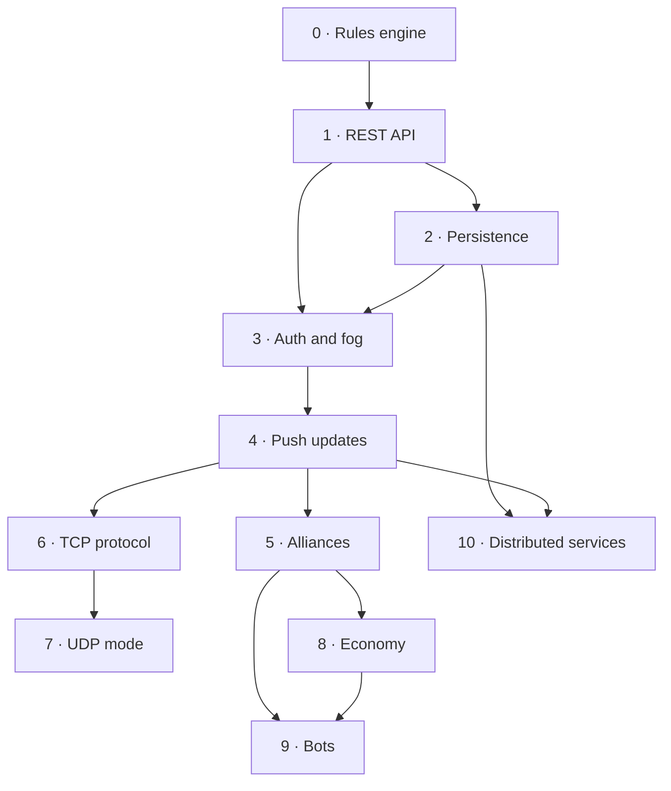

# Development Phases

Each phase is one teaching unit: a playable problem, the concepts that solve
it, and a demo that proves it works. Phases 2, 4, 6, 7 and 10 are about how
state travels; the rules stay put.



Suggested effort assumes a 2–3 hour session per "session" block.

| Phase | Sessions | Demo at the end |
| --- | --- | --- |
| 0 | 2 | Hot-seat game in one terminal, rules fully tested |
| 1 | 2–3 | Two terminals, one server, ANSI REST client |
| 2 | 2 | Restart the server mid-game and keep playing |
| 3 | 2 | Two clients see different maps |
| 4 | 2 | Moves appear without pressing a key |
| 5 | 2 | Two-player alliance blocks an attack |
| 6 | 2–3 | Same terminal client over length-prefixed TCP |
| 7 | 3 | Pygame client survives packet loss |
| 8 | 2 | Resource nodes and upkeep change strategy |
| 9 | 2 | Four bots play a tournament unattended |
| 10 | 3+ | Services restart independently, game survives |

---

## Phase 0 — Rules engine and hot-seat game

**The problem:** we cannot network a game that does not exist.

**Concepts:** dataclasses, pure functions, separation of concerns, unit
testing, seeded randomness, ASCII rendering, the command pattern.

**Build**

1. Package layout (see architecture doc): `core/`, `protocol/`, `client/`,
   `server/` (empty for now), `tests/`.
2. `core/state.py`: immutable `GameState`, `Player`, `Tile`.
3. `core/board.py`: seeded map generation, capital placement, adjacency
   helpers, coordinate validation.
4. `core/rules.py`: `apply_action(state, player_id, action) -> (state, events)`
   implementing expand, fortify, attack, end turn. Raise typed domain errors,
   never string exceptions.
5. `core/scoring.py`: territory percentage, standings, elimination checks.
6. `client/render.py`: pure state → frame data functions for the board, HUD
   and status panel; `client/ansi.py` serialises that data into escape
   sequences. Nothing here does I/O. The terminal client, the Phase 7 Pygame
   view and the tests all consume the same `ClientState` and frame data.
7. `client/app.py` + `client/hotseat.py`: a minimal ANSI terminal shell with
   alternate screen, key-at-a-time input and `try/finally` restoration. In
   hot-seat mode it renders the board, asks for a command and calls
   `apply_action`. No sockets. This is the reference implementation of the
   game.
8. Tests:
   - golden test for a known seed (board hash, capital positions);
   - one test per legality checklist rule;
   - combat table from the mechanics doc, one test per worked example;
   - elimination and scoring tests;
   - a full scripted game replayed from a fixed action list.

**Definition of done**

- `pytest` green with no network or database in `core/` tests.
- A scripted 20-round game completes and produces standings.
- `GameState` is never mutated in place; tests assert the input state is
  unchanged after `apply_action`.

**Pitfalls to let students hit, then fix**

- `(x, y)` vs `(row, column)` confusion in the renderer. Fix by naming
  variables `x`/`y` and testing a non-square map.
- Mutating the state and returning the same object, then being surprised that
  "undo" and replay are impossible.
- Putting rendering logic inside rules; the rules start returning strings.

**Stretch:** property-based tests (Hypothesis) asserting invariants: strength
never negative, no neutral tile has strength > 0, territory totals never exceed
land tiles.

---

## Phase 1 — REST API

**The problem:** two players need to share one board, and a terminal UI should
not own the game state.

**Concepts:** HTTP verbs and status codes, REST resources, JSON schemas,
request validation, client/server split, stateless requests, error taxonomies.

**Build**

1. `protocol/models.py`: request/response DTOs (Pydantic). Shared by server and
   client so drift is a type error, not a runtime surprise.
2. `server/app.py`: FastAPI app with an in-memory `GameStore` (dict of games).
3. Endpoints — the README's four plus the minimum needed to run a game:

   ```http
   POST /games                     create a game (board size, seed, rounds)
   POST /games/{id}/join           {"name": "alex"}
   POST /games/{id}/start          requires 2+ players
   GET  /games/{id}/state          full state for the requesting player
   POST /games/{id}/actions        {"type": "expand", ...}
   POST /games/{id}/end-turn
   GET  /games/{id}/events?since=  action log for the UI and tests
   ```

   The README's `POST /move` and `POST /attack` are the first cut. Prefer one
   typed `actions` endpoint with a `type` discriminator: it validates in one
   place, and adding the next action does not add an endpoint. If you keep the
   split endpoints, make the refactor an explicit exercise in Phase 2.
4. Map domain errors to HTTP: `400` malformed, `403` not your turn/no
   permission, `404` unknown game, `409` illegal action in current state,
   `422` schema validation (FastAPI default).
5. `client/session/base.py`: the synchronous `Session` facade (`send`,
   `drain_events`, `close`). `client/session/rest.py` implements it over
   `httpx` on a worker thread; the UI never imports `httpx`.
6. `client/app.py`: the custom ANSI terminal client — alternate screen,
   non-blocking key polling, board/status/command screens, a 1-second polling
   timer, and connection/error status. Polling sends a command and drains
   events; it never blocks the render loop.
7. Integration tests: spin up the app with `httpx.ASGITransport`, play a
   scripted game over HTTP.

**Definition of done**

- Two terminal clients on one server can complete a game.
- The client never computes legality; it displays the server's error.
- The terminal is restored on normal exit and on a server error.
- OpenAPI docs at `/docs` explain every endpoint well enough for a classmate
  to write a client from them.

**Discussion prompts**

- Why `409` and not `400` for "not your turn"? What changes for the client?
- What is in the response that the client does not need? What is missing?
- What happens if two clients send an action at the same time?

**Deliberate bug to plant:** the in-memory store is read-modify-write without
a version check. Two fast clients cause a lost update. Do not fix it yet; it is
the Phase 3/4 hook.

---

## Phase 2 — Persistence

**The problem:** restarting the server deletes every game.

**Concepts:** relational modelling, SQL, ORM vs raw SQL, migrations, the
repository pattern, transactions, indexes, test fixtures.

**Build**

1. SQLite via SQLAlchemy 2.0. Tables: `games`, `players`, `tiles`, `events`,
   `turns`. Decide what is normalised (tiles) and what is a document (the event
   payload).
2. Repository interface in the server layer; `core` still knows nothing about
   databases. Test the repository against a temporary database.
3. Load a game on demand, write back after each action in one transaction.
4. Alembic migrations from the first schema. Introduce a second migration that
   adds a column (e.g. `players.reputation`) so schema evolution is practised.
5. Seed/reset CLI command for the classroom.
6. Indexes: `tiles(game_id)`, `events(game_id, seq)`. Measure a query with
   `EXPLAIN QUERY PLAN`.

**Definition of done**

- Kill the server mid-game, restart, rejoin, continue.
- A completed game is still readable after restart.
- Migration from an empty database runs in CI.
- No SQL strings in route handlers.

**Pitfalls:** N+1 queries when loading tiles per player, storing state as one
giant JSON blob and calling it modelling, no transaction around
read-modify-write, migrations edited after being applied.

**Stretch:** write the same repository twice, once raw `sqlite3` and once ORM,
and compare readability and query counts.

---

## Phase 3 — Authentication, server authority and fog of war

**The problem:** anyone can claim to be anyone, and the client can see the
whole map.

**Concepts:** authentication vs authorisation, tokens, hashing, secrets,
per-player data views, filtering at the boundary, optimistic concurrency,
threat modelling.

**Build**

1. Players register with a name and password; passwords hashed (Argon2 or
   bcrypt). Tokens issued on login and required on every game endpoint.
2. Replace "player id in the URL/body" with "player id from the token".
3. Implement fog of war in `core/vision.py` as a pure function:
   `visible_state(state, viewer) -> PlayerView`. The server serialises the
   view, never the full state.
4. Add `version` to the game state and require `expected_version` on actions.
   Return `409 CONFLICT` with the current version; the client refetches and
   retries. This fixes the Phase 1 lost-update bug.
5. Add `Idempotency-Key` support for actions so a retried request cannot
   double-spend. Store key → result for a short window.
6. Tests: player A cannot read B's strength in fog; expired token rejected;
   action with stale version rejected; replayed idempotency key returns the
   original result.

**Definition of done**

- Two clients see different maps from the same game.
- A stolen token is the only way to act as another player, and tokens expire.
- Cross-player data leakage test exists and passes.
- The client handles `409` by refetching, not by crashing.

**Discussion prompts**

- Why hash passwords if the database is private?
- Is the seed secret? (No — but it lets a client regenerate the map, so treat
  it as public and keep hidden state out of it.)
- What is the difference between hiding data and not sending it?

**Stretch:** rate-limit login attempts; add a simple audit log of rejected
actions.

---

## Phase 4 — Real-time updates

**The problem:** polling every second feels dead, wastes requests, and hides
the fact that state changes are events.

**Concepts:** WebSockets, publish/subscribe, event streams, deltas vs
snapshots, reconnect and resync, heartbeats, backpressure, concurrency in an
async server.

**Build**

1. `WS /games/{id}/stream?token=...`: authenticate, subscribe to a game, send
   an initial full snapshot with `version`, then deltas.
2. Define the envelope once:

   ```json
   {"type": "state_delta", "game_id": "...", "version": 43, "events": [...]}
   ```

3. Keep REST for commands initially. Move commands onto the socket in a second
   step and compare error handling and latency.
4. Client: a network worker thread owns the socket and pushes immutable events
   into a bounded `queue.Queue`. The main thread drains input and the queue,
   reduces them into `ClientState`, and renders on change at a capped frame
   rate. No socket call runs on the render thread. Add optimistic rendering
   only in Phase 7.
5. Reconnect: exponential backoff, `since_version` on resubscribe, server
   sends missed events or a fresh snapshot.
6. Heartbeat ping/pong; drop dead connections. Test with a client that never
   reads (slow consumer) and decide on a policy: buffer with a cap, then send a
   snapshot.
7. Measure: requests per minute before/after, time from action to visible
   change.

**Definition of done**

- A move appears on the opponent's screen without input.
- Killing the socket mid-game reconnects and converges to the same state.
- No state divergence after a 20-round test game with random disconnects.
- The UI stays responsive during a 3-second server delay; the event queue
  stays bounded.
- Server stays responsive with at least 10 concurrent clients.

**Pitfalls:** broadcasting the full state on every event; per-connection
`asyncio.sleep` polling loops; forgetting to remove subscriptions; sending
events before the snapshot.

**Stretch:** server-driven turn timer ticks over the same channel.

---

## Phase 5 — Alliances and diplomacy

**The problem:** the game is purely zero-sum, so the social layer is missing.

**Concepts:** multi-party state, relationship modelling, permission rules that
depend on other players, privacy boundaries, expiry/cooldowns, state machines
for proposals.

**Build**

1. `Proposal` states: `pending → accepted | declined | expired`. Store
   `created_round`, expire at the start of a round.
2. `Alliance` as a symmetric entity, not a flag on each player. Derive
   "are these two allied?" from it.
3. Enforce the attack restriction inside `core` (single source of truth), not
   only in the route.
4. Shared vision: union of both visibility sets, applied in
   `visible_state(...)`.
5. Transfers: validate balance, one per round per alliance, 1 AP.
6. Betrayal cooldown and reputation counter.
7. Tests: 3-player triangle (A–B allied, B–C allied, A–C not); attack blocked;
   breaking allows an attack on the next action; cooldown blocks re-allying.

**Definition of done**

- Diplomacy works with four players, including a 3-way alliance.
- A player cannot "launder" resources through an ally to bypass a cooldown
  (define and test the rule).
- The renderer distinguishes allies from enemies.

**Discussion prompt:** should shared vision reveal an ally's stale memory
(map knowledge), or only what they currently see? Pick one and defend it.

---

## Phase 6 — TCP rewrite

**The problem:** HTTP headers and request/response semantics are a bad fit for
a game that is mostly a stream of small commands and events. We want to see
what HTTP is doing for us by building without it.

**Concepts:** sockets, TCP streams vs message boundaries, framing, partial
reads, encoding, handshakes, concurrency (threads or asyncio), graceful
shutdown, slow clients.

**Build**

1. A framed protocol: 4-byte big-endian length + UTF-8 JSON payload. Agree on
   a maximum frame size.
2. Message types: `hello`, `login`, `join`, `action`, `end_turn`, `state`,
   `event`, `error`, `ping`.
3. Server: `asyncio.start_server`, one task per connection, a shared game
   registry with an `asyncio.Lock` per game. Reuse `core` and the existing
   handlers — this phase must not duplicate rules.
4. Client: `TcpSession` behind the same `Session` facade. A reader thread
   parses length-prefixed frames into the event queue; a writer queue
   serialises commands. `--transport http|ws|tcp` switches adapters, not the
   UI. `asyncio` is fine on the server; the terminal client does not need it.
5. Tests: send half a header, then the rest; send two frames in one `send`;
   kill the connection mid-frame. All three are classic framing bugs.
6. Keep HTTP and WebSocket alongside TCP behind `--transport http|ws|tcp` in
   the client, so the comparison is honest.

**Definition of done**

- A full game over TCP with the terminal client.
- The framing test suite passes against a deliberately flaky byte stream.
- No blocking `recv` inside async code; no unbounded per-connection buffers.
- README documents the wire format with a hexdump example.

**Pitfalls:** assuming one `recv` equals one message; decoding partial UTF-8;
holding a global lock while awaiting network writes; forgetting to close
sockets on shutdown.

**Stretch:** binary encoding with `struct` and measure the byte savings.

---

## Phase 7 — UDP battlefield mode

**The problem:** TCP hides loss and ordering, so students never see the hard
parts of real-time networking. Make the unreliable channel explicit.

**Concepts:** UDP, datagrams, packet loss, duplication, reordering, sequence
numbers, acknowledgements, unreliable vs reliable channels, snapshots vs
deltas, client prediction, reconciliation, jitter, MTU.

**Build**

1. Enable real-time mode (mechanics §10): AP and income on timers.
2. Server sends state snapshots at 10 Hz over UDP, each with `tick` and
   `version`. Only send tiles that changed since the last acked snapshot
   (delta), with periodic keyframes.
3. Critical commands (actions) go over a reliable channel. Start with a simple
   ack + retransmit layer:
   - command `seq`, server replies `ack seq`;
   - client retries after 200 ms with exponential backoff;
   - server deduplicates by `(player, seq)` (this is Phase 3's idempotency
     lesson, now unavoidable).
4. Pygame client (`client/visual/`):
   - a 60 FPS render loop with 10 Hz UDP snapshots and a two-snapshot
     interpolation buffer;
   - sequence-number gap detection → request a keyframe or ignore stale
     snapshots;
   - timestamped snapshots for interpolation;
   - optimistic local render of your own action, then reconcile against the
     next authoritative snapshot, rolling back on mismatch;
   - a network worker thread and bounded queue behind the shared `Session`
     facade;
   - a tile grid, HUD, event log and mouse/keyboard selection;
   - a debug overlay: tick, last ack, packet loss estimate, correction count,
     queue depth and FPS.
5. Chaos tools: an in-process `LossyProxy` (`drop=10%`, `duplicate=5%`,
   `reorder=5%`, `delay=50ms ± 20ms`) plus a UI toggle. Every test runs through
   the proxy at least once.
6. Tests: duplicate command applied once; out-of-order snapshot discarded;
   dropped snapshot recovered by the next keyframe; 20% loss still converges.

**Definition of done**

- A 5-minute real-time match survives 10% loss and 50 ms jitter.
- The Pygame client renders at 60 FPS from 10 Hz snapshots and stays smooth
  between them.
- The debug overlay reports corrections, and they trend to zero when the
  network is clean.
- Killing packets for 2 seconds does not permanently desynchronise the client.
- Headless Pygame tests pass with `SDL_VIDEODRIVER=dummy`.
- The terminal client still plays the Phase 6 game.
- Rules tests from Phase 0 still pass untouched.

**Pitfalls:** sending authoritative state only in deltas (a lost keyframe
desyncs forever); using wall-clock time for game time; trusting client-supplied
timestamps for cooldowns; retrying non-idempotent commands.

**Stretch:** separate channels for reliable commands and unreliable state;
bandwidth budget per player; compare JSON vs binary snapshots.

---

## Phase 8 — Economy layer

**The problem:** expansion is always correct, so strategy collapses into "grab
land".

**Concepts:** simulation loops, tick scheduling, integer arithmetic, balancing
via experiments, configuration, making game design testable.

**Build**

1. Add terrain yields, upkeep and ruins from mechanics §11.
2. Put every number in one `core/balance.py` (or a TOML file) with typed
   fields. No magic numbers in rules.
3. Implement `tick(state)` as a pure function; the scheduler only decides when
   to call it.
4. Build a headless simulator: N seeded games, bots from Phase 9 or a simple
   scripted policy, report win rates and average game length. Use it to tune
   the numbers, and commit the report.
5. UI: income breakdown, upkeep line, next-tick countdown in real-time mode.

**Definition of done**

- Income shown in the UI equals `sum(yields) - upkeep` exactly, verified by a
  test.
- A config change requires no code change.
- The balance report supports the chosen defaults (or documents why not).
- Existing rules tests unaffected when upkeep is zero.

**Discussion prompt:** which is better, a flat upkeep per N tiles or a cost per
tile that rises with distance from the capital? Model both, measure both.

---

## Phase 9 — AI players

**The problem:** there is nobody to play against at 2 a.m., and a good API
should be usable by a machine.

**Concepts:** agents, evaluation functions, heuristics, search, benchmarking,
determinism in experiments, test harnesses, rate limits.

**Build**

1. `bots/client.py`: a headless client that logs in, joins, reads state and
   submits actions through the public protocol.
2. `bots/heuristic.py`: score legal actions with the table in mechanics §12,
   pick the best, break ties deterministically (by coordinates) so tournaments
   are reproducible.
3. `bots/personalities.py`: weight vectors for Turtle, Rusher, Opportunist.
4. `bots/tournament.py`: round-robin over fixed seeds; output wins, average
   placement, average rounds, invalid-action rate (must be 0).
5. Server: bots are normal players, so no special endpoints. Add rate limiting
   only if a bot misbehaves — and then it applies to humans too.
6. Stretch: minimax/expectimax with a small depth, MCTS, or a learned policy.

**Definition of done**

- Four bots complete 20 games unattended with zero rejected actions.
- A bot loses to a competent human but beats a random actor reliably.
- Tournament output is deterministic for a fixed seed list.
- Bots do not crash the server or leak state they should not see (fog applies
  to bots too).

---

## Phase 10 — Distributed architecture

**The problem:** one process owns everything, cannot scale independently, and
a chat message can take down a game.

**Concepts:** service boundaries, ownership of data, synchronous vs
asynchronous communication, message brokers, eventual consistency, idempotent
consumers, service discovery, observability, failure injection.

**Build**

1. Split into services:
   - **Auth** — accounts, tokens, sessions.
   - **Game** — the rules engine, authoritative state, turn/real-time loop.
   - **Chat** — messages per game and global lobby.
   - **Leaderboard** — consumes game-finished events, computes Elo/rankings.
   - Optional **Gateway** — one public entry point, routes to services.
2. Shared infrastructure: PostgreSQL (or keep SQLite for game state if you
   must, but then document the single-writer limit) and a broker such as Redis
   Streams, NATS or RabbitMQ. Keep the broker local (Docker Compose) so the
   classroom network is not a dependency.
3. Events become the integration contract: `game.finished`, `player.joined`,
   `chat.message`. Version the event schemas.
4. Leaderboard consumes `game.finished` idempotently (event id + dedupe table)
   and tolerates replays. Demonstrate duplicate delivery.
5. Token validation: auth service issues, game service verifies (shared public
   key or introspection endpoint). Discuss revocation.
6. Observability: structured logs with `game_id`/`player_id`, request ids,
   metrics (actions/s, active games, WS connections, p95 latency), traces
   across two services.
7. Failure drills: kill the leaderboard during a game (game unaffected); kill
   the game service (clients see a clear error, auth still works); partition
   the broker (events buffer or drop with a metric, documented choice).
8. `docker compose up` starts the whole system; README has a topology diagram.

**Definition of done**

- Game, auth, chat and leaderboard deploy and restart independently.
- A finished game appears on the leaderboard without a synchronous call from
  the game service.
- Duplicate `game.finished` events do not double-count a win.
- An incident drill has a written outcome: what broke, what the user saw.
- No service reaches into another service's database.

**Discussion prompt:** where exactly does "eventual consistency" become
visible to a player, and is that acceptable? (Leaderboard yes, turn state no.)

---

## Cut lines

| Course length | Phases | What students walk away with |
| --- | --- | --- |
| 4 weeks | 0–2 | Pure logic, testing, REST, SQL, a real playable multiplayer game |
| 6 weeks | 0–4 | Plus auth, server authority, fog of war, push updates |
| 9 weeks | 0–7 | Plus diplomacy, sockets, framing, UDP and prediction |
| Full course | 0–10 | Plus simulation, agents, distributed systems and operations |

Whatever you cut, keep Phase 0. A networked game with untested rules teaches
debugging by fire; a tested rules engine makes every later phase about the
actual topic.

## Cross-cutting tracks (run every phase)

- **Tests** grow with the code: unit tests in `core`, integration tests over
  the real transport, one end-to-end game per phase.
- **CI** runs lint, type-check and tests on every push. No phase is done with a
  red pipeline.
- **Docs** — the README's protocol section is updated in the same commit as the
  protocol change.
- **Review** — one student reviews another's phase branch against the
  definition of done. Reviewing is part of the curriculum.
- **Retro** — 10 minutes at the end of each phase: what broke, what would you
  design differently, what did the network force you to learn?
