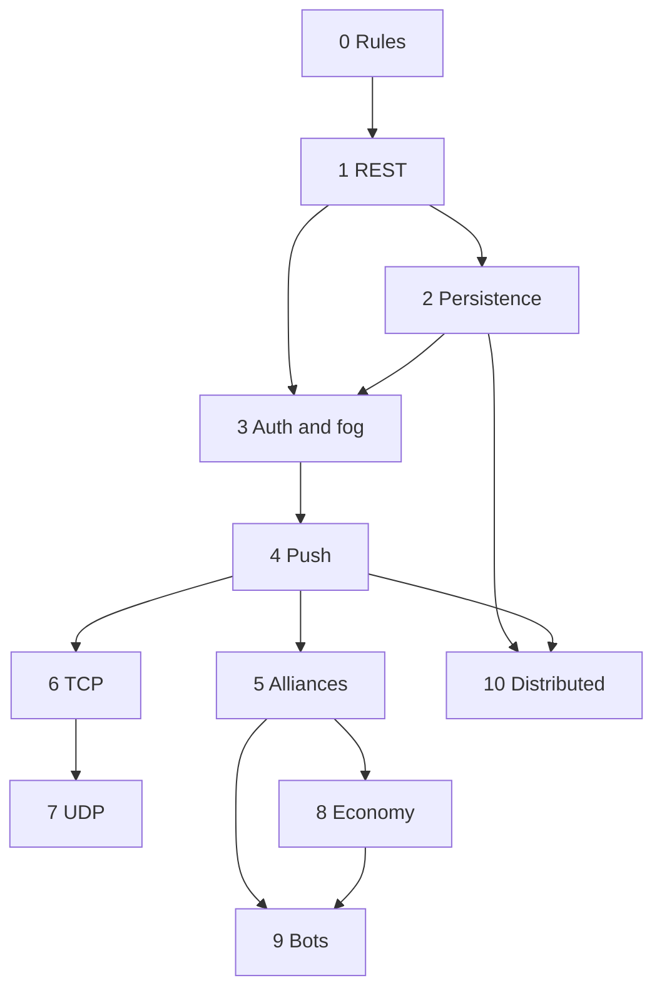

# Development Phases

Each phase is a learning unit, not a build ticket. It adds one player-visible
problem and the concept that solves it, then ends with a demo you can show
someone. The rules in [01-game-mechanics.md](01-game-mechanics.md) stay fixed
except where the rules-change table below says otherwise.

The order is deliberate: the game exists first, then it is shared, trusted,
live, social, low-level, fast, balanced, autonomous, and distributed. Every
phase reuses the previous one; none is a side project.

## Phases at a glance

| Phase | The problem | Concept | Demo / exit |
| --- | --- | --- | --- |
| 0 | The game does not exist yet | Pure rules and local turns | A hot-seat game in one terminal |
| 1 | One terminal cannot share a game | HTTP, JSON, validation | Two terminals, one board |
| 2 | Restarting loses the game | SQL and transactions | Restart mid-game and continue |
| 3 | Identity and visibility are absent | Auth, server authority, conflicts | Two clients see different maps |
| 4 | Polling feels dead | WebSockets, events, reconnection | An opponent's move appears unprompted |
| 5 | The game is purely zero-sum | Relationships and permissions | An alliance blocks an attack |
| 6 | HTTP overhead dominates | Streams and framing | The same client over TCP |
| 7 | Real-time play is unreliable | Datagrams, loss, sequencing, prediction | A match survives packet loss |
| 8 | Expansion is always right | Simulation and balancing | Upkeep changes strategy |
| 9 | There is no opponent at 3 a.m. | Agents and benchmarking | Four bots play unattended |
| 10 | One process owns everything | Service boundaries, eventual consistency | Services restart independently |

## Phase 0 — Rules engine and hot-seat game
**Problem:** the game does not exist yet, so there is nothing to network.
**Concept:** pure rules, deterministic maps, local turns.
**Scope:**
- A board, capitals, turns, and the two-currency economy.
- Expand, fortify, attack, surrender, elimination, and scoring.
- Two people playing locally on one keyboard.

**Exit demo:** a complete game played locally in one terminal.
**Hard parts:** how to keep the newly-captured restriction consistent across
Expand, Fortify, and Attack; what the rules must expose so later transports stay
thin; which mistakes only appear at the end of a 20-round game.

## Phase 1 — REST API
**Problem:** one terminal cannot share a game; the board lives wherever the UI lives.
**Concept:** HTTP, JSON, REST resources, request validation, client/server split.
**Scope:**
- A server that owns the game and answers requests.
- Multiple players joining and playing the same board.
- Distinct, stable errors for illegal or unauthorized requests.

**Exit demo:** two terminals play one shared game.
**Hard parts:** how much state one response should carry; what the client shows
when an action is rejected; what happens when two requests arrive at once.

## Phase 2 — Persistence
**Problem:** restarting the server deletes every game.
**Concept:** relational modelling, SQL, transactions, migrations.
**Scope:**
- Games, players, tiles, and history survive a restart.
- A schema that can evolve without losing existing games.
- A clean boundary between storage and rules.

**Exit demo:** restart mid-game, rejoin, and continue.
**Hard parts:** what deserves a table and what is a document; which
read-modify-write needs a transaction; when a migration becomes irreversible.

## Phase 3 — Identity, authority, and fog
**Problem:** anyone can claim to be anyone, and every client sees the whole map.
**Concept:** authentication, authorization, per-player views, conflict handling.
**Scope:**
- Accounts and sessions, so a player is who they say.
- Views filtered by what that player may know; hidden data never leaves the server.
- Detection of stale or repeated commands.

**Exit demo:** two clients see different maps and different errors.
**Hard parts:** hiding data versus not sending it; what a client may infer from
public data; how much conflict handling the interface should absorb.

## Phase 4 — Push updates
**Problem:** polling every second feels dead and wastes requests.
**Concept:** WebSockets, event streams, snapshots versus deltas, reconnection.
**Scope:**
- The server pushes changes; the client reacts without input.
- A reconnect story: missed events or a fresh snapshot.
- Bounded buffering when a client falls behind.

**Exit demo:** an opponent's move appears on screen unprompted.
**Hard parts:** full snapshots versus deltas; what a slow consumer sees; where
the server's truth ends and the client's optimism begins.

## Phase 5 — Alliances and diplomacy
**Problem:** the game is purely zero-sum, so there is no social layer.
**Concept:** relationship modelling, permissions that depend on other players,
expiry and cooldowns.
**Scope:**
- Proposals and alliances with explicit states.
- Attacks and vision that depend on who is allied.
- Resource transfers, betrayal, and a re-ally cooldown.

**Exit demo:** an alliance visibly blocks an attack for both players.
**Hard parts:** is an alliance a shared relationship or two private settings; do
allies share memory or only current sight; can resources launder through a
friend.

## Phase 6 — TCP
**Problem:** HTTP headers and request/response semantics are heavy for a stream
of small commands.
**Concept:** sockets, TCP streams, framing, partial reads, concurrency.
**Scope:**
- The same commands and events over a length-delimited stream.
- Several clients per game with clean shutdown.
- An honest comparison against the HTTP path.

**Exit demo:** a full game over TCP with the same client.
**Hard parts:** message boundaries over a byte stream; partial writes and slow
readers; what is gained and lost when HTTP is no longer doing the work.

## Phase 7 — UDP battlefield
**Problem:** TCP hides loss and ordering, so real-time play never shows its hard parts.
**Concept:** UDP, datagrams, loss, reordering, sequence numbers, interpolation,
prediction.
**Scope:**
- Real-time rules: actions on a timer, no turn order.
- Snapshots at a fixed rate with recovery from gaps.
- A visual client with interpolation and an honest debug view.

**Exit demo:** a match stays playable through loss and jitter.
**Hard parts:** what may be predicted and what must wait; when a correction
becomes visible; how the game recovers after a brief blackout.

## Phase 8 — Economy
**Problem:** expansion is always correct, so strategy collapses into grabbing land.
**Concept:** simulation, tick scheduling, balancing through experiments,
configuration.
**Scope:**
- Upkeep, terrain yields, ruins, and trade bonuses.
- Balance numbers that are easy to change as a set.
- A headless way to compare balance choices.

**Exit demo:** upkeep makes wide expansion a real cost.
**Hard parts:** which knob actually changes behaviour; how much upkeep is
punishing rather than unplayable; whether a simulation predicts human play.

## Phase 9 — Bots
**Problem:** there is nobody to play against at 3 a.m.
**Concept:** agents, evaluation functions, benchmarking, determinism in experiments.
**Scope:**
- Bots that use the same public protocol as a human.
- Personalities as preference weights, not separate rules.
- A repeatable way to compare bots against each other and against people.

**Exit demo:** four bots complete a tournament unattended.
**Hard parts:** what a bot is allowed to see; how ties stay reproducible; how to
tell a good bot from a lucky one.

## Phase 10 — Distributed
**Problem:** one process owns everything, so nothing scales or fails independently.
**Concept:** service boundaries, asynchronous events, eventual consistency,
observability.
**Scope:**
- Separate services for identity, games, chat, and standings.
- Events as the contract between services.
- Independent restart and deliberate failure drills.

**Exit demo:** services restart independently while a game survives.
**Hard parts:** where eventual consistency becomes visible to a player; who owns
shared data; what happens when the broker is unavailable.

## Building Phase 0

A conceptual ladder for the first phase; each rung is one idea, not a task list.

- **Model:** players, capitals, owned tiles, strength, resources.
- **Board and capitals:** seeded map, quadrants, land connectivity.
- **Turns and economy:** income, action points, end turn.
- **Expand:** claim adjacent neutral land; no chaining through fresh captures.
- **Fortify:** spend resources to raise a garrison up to its cap.
- **Attack:** choose source, target, and committed strength; repel or capture.
- **Victory and scoring:** elimination, territory share, tie-breakers.
- **Terrain:** expand cost, defense, and impassable water.
- **Client integration:** the rules drive the local interface, never the reverse.

## Rules change by version

| Version | Phase | Rules change |
| --- | --- | --- |
| v1 | 0 | Core: setup, actions, economy, victory. |
| v2 | 2 | None — storage only. |
| v3 | 3 | Fog of war. |
| v4 | 4 | None — transport only. |
| v5 | 5 | Alliances and diplomacy. |
| v6 | 6 | None — transport only. |
| v7 | 7 | Real-time mode. |
| v8 | 8 | Economy layer. |
| v9 | 9 | None — bots obey existing rules. |
| v10 | 10 | None — service boundaries only. |

Most phases about how state travels leave the rules alone. Only fog, diplomacy,
real-time, and the economy layer change what a player can do.

## Scope choices

| If you stop after | You have |
| --- | --- |
| Phases 0–2 | A tested local game, served over REST and stored in SQL. |
| Phases 0–4 | Plus identity, fog, and live updates: a real multiplayer game. |
| Phases 0–7 | Plus diplomacy, raw TCP, and real-time UDP with prediction. |
| Phases 0–10 | The full path, including simulation, bots, and distributed services. |

This is personal pacing. Whatever you cut, keep Phase 0: a
networked game with untested rules makes every later phase about debugging.

## Habits that make each phase work

- Test the rules against 01, especially the worked examples.
- Keep one end-to-end game working at the end of every phase.
- Write down each decision and the alternative you rejected.
- Spend ten minutes reflecting: what broke, and what the network forced you to learn.
