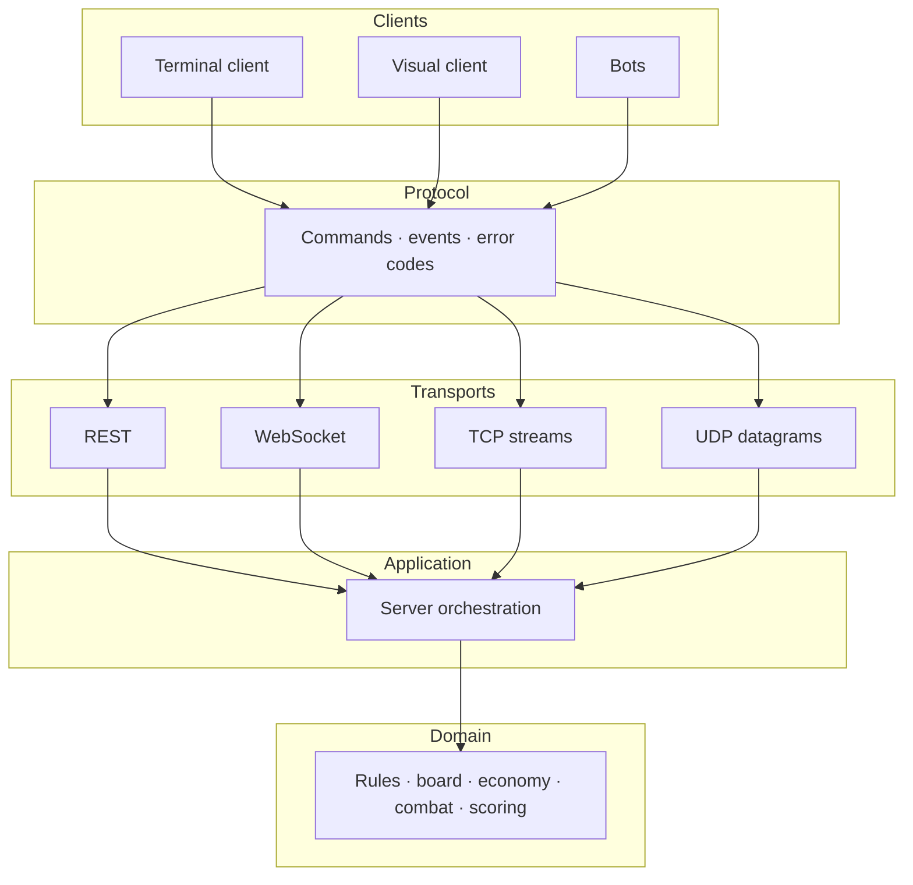

# Architecture

The architecture keeps the rules independent of how players connect: a transport
can be replaced without editing the domain, and a client without changing the server.

## 1. Layering

Arrows show message flow; dependencies point inward toward the domain.

## 2. Dependency rules

- **Core is pure domain.** No UI, network, database, clock, or environment: every
  rule is testable without a server, screen, or file.
- **Protocol is the shared wire language.** Commands, events, and error codes live
  in one place, so the two sides cannot drift into different dialects.
- **Server orchestrates.** It owns identity, coordination, and durability, keeping
  those concerns out of the rules.
- **Clients render state and send intentions.** They never decide legality, so the
  server remains the only authority and hidden information never leaves it.
- **Transports are edge adapters.** Replacing one changes latency and failure
  modes, not game semantics.
- **Nothing imports a client.** The core and server stay usable by tests, bots,
  and any future client.

## 3. Invariants

1. **The server is authoritative.** A client may propose; only the server decides.
2. **Transitions are immutable.** Every accepted command returns a new state plus
   events; the previous state is never edited.
3. **One writer per game.** Commands are serialised even when reads are concurrent.
4. **Conflicts are rejected, not merged.** Each accepted command advances a
   version; a stale write fails instead of overwriting newer state.
5. **Events are the observable interface.** They describe player-visible change
   and feed the UI log, replays, and later consumers.
6. **There is one transport seam.** Clients speak intentions and receive events,
   not a wire format.
7. **A rejected command changes nothing.** Validation finishes before any cost is paid.
8. **Hidden information is filtered before it leaves the server.** Hiding it in
   the client is not hiding it.

## 4. Delivery and topology evolution

| Phase | Mechanism | What changes | What the player notices |
| --- | --- | --- | --- |
| 1 | REST request/response with polling | Updates must be asked for; request latency is visible | The board feels stale until refresh |
| 2 | Persistence | State must survive a process restart; reads and writes cross a storage boundary | Rejoining after a restart works |
| 4 | WebSocket push | The server initiates messages; ordering and reconnect matter | Moves appear on their own |
| 6 | TCP streams with length-prefixed frames | Message boundaries must be rebuilt from a byte stream | Little, on a healthy connection |
| 7 | UDP datagrams and snapshots | Loss, duplication, and reordering are normal; snapshots and interpolation appear | Smooth motion, with visible corrections |
| 10 | Service boundary | One process becomes several and events cross a network | Failures become partial and need explaining |

Across every row, the commands, events, and rules are unchanged. Phases 2, 4, 6,
and 7 change storage or delivery; Phase 10 changes ownership, not meaning.

## 5. Concurrency and consistency

| Phase | Approach |
| --- | --- |
| 1 | One in-memory store; two fast clients can still overwrite each other's read-modify-write |
| 2 | Each command is one atomic storage transaction, not a partial write |
| 3 | Optimistic concurrency: a write succeeds only if the version still matches, otherwise the client receives a conflict |
| 4 | A per-game lock serialises commands; events are published only after the new state is committed |
| 6 | The same lock is shared by every handler that can touch that game |
| 7 | Snapshot readers use an immutable state reference and never block play |
| 10 | Exactly one service writes a game; the rest consume events and are eventually consistent |

Only one place mutates a game, under a per-game lock with a version check.

## 6. Testing philosophy

- **Domain tests are pure.** No I/O or clock; rules, formulas, and edge cases,
  exhaustively.
- **Protocol tests round-trip every message** and reject malformed input.
- **Integration uses the real transport.** A mock cannot prove framing, status
  codes, or reconnects.
- **Chaos tests cover loss, duplication, reordering, slow consumers, and
  disconnects.**
- **A bug fix starts with a failing test** that names the broken rule.
- **Determinism makes assertions exact.**

## 7. Decisions worth recording

- Server authority from the first networked phase, before identity exists.
- Immutable state plus an append-only event stream.
- JSON on the wire until latency is measured; then consider binary.
- SQLite first for one node; PostgreSQL when concurrency and services demand it.
- One transport seam, four implementations.
- The terminal client is the reference; a graphical client is only for real time.
- Each decision gets a short record: context, decision, consequences, and what
  would change it.
