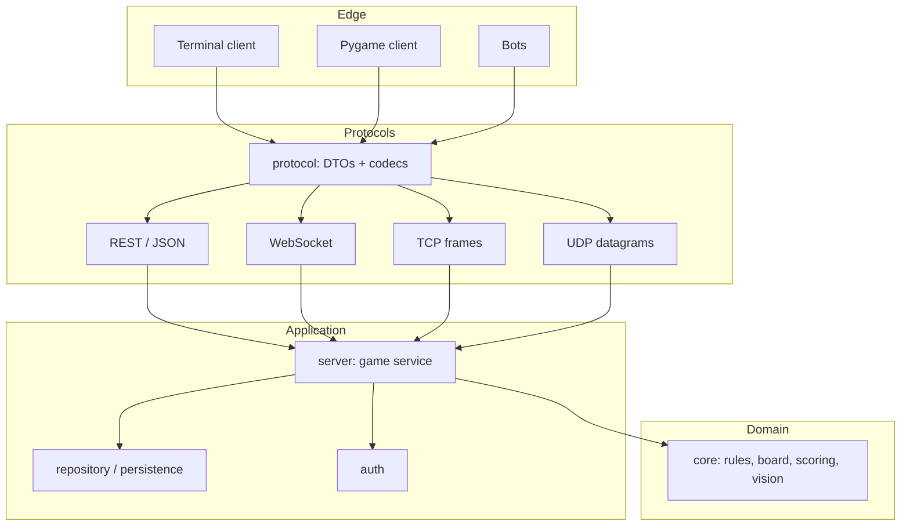

# Architecture

The architecture exists to make one promise: **the rules never change when the
transport does**. Every phase after 1 is a change at the edge.

---

## 1. Layering



Dependency rule, enforced by review and (optionally) an import-linter check:

- `core` may import Python standard library only. Not Pydantic, not FastAPI,
  not any UI toolkit (Textual, Pygame, Rich), not SQLAlchemy.
- `protocol` may import `core` types and Pydantic.
- `server` may import `core` and `protocol`.
- `client` may import `protocol` (and `core` for rendering helpers, never for
  deciding legality). The one exception is `client/hotseat.py`, which acts as
  the referee in Phase 0 and may call `apply_action`; it is deleted or kept as
  a dev tool once the server exists.
- Only `client/session/` may import transport libraries (`httpx`, `websockets`,
  `socket`, `asyncio`). Screens and renderers never do.
- Only `client/visual/` may import `pygame`.
- Textual lives only under `client/experiments/`; do not import it from
  `client/`.
- Nothing imports `client`.

If a rule needs the database, it is not a rule.

---

## 2. Target layout

```text
terminal-territories/
├── pyproject.toml
├── README.md
├── human_notes.md
├── planning/
└── terminal_territories/
    ├── __init__.py
    ├── core/                 # pure domain
    │   ├── balance.py        # every tunable number, one place
    │   ├── board.py          # generation, adjacency, bounds
    │   ├── state.py          # GameState, Tile, Player
    │   ├── actions.py        # action types + parsed commands
    │   ├── rules.py          # apply_action, validation
    │   ├── combat.py         # attack resolution
    │   ├── vision.py         # fog of war projection (v3)
    │   ├── diplomacy.py      # alliances, proposals (v5)
    │   ├── scoring.py        # standings, victory
    │   ├── events.py         # domain events
    │   └── errors.py         # typed domain errors
    ├── protocol/
    │   ├── models.py         # wire DTOs
    │   ├── codec.py          # JSON encode/decode, TCP framing, UDP packets
    │   └── errors.py         # error codes shared with clients
    ├── server/
    │   ├── app.py            # FastAPI wiring
    │   ├── service.py        # orchestration, transactions, locks
    │   ├── store.py          # in-memory and SQL repositories
    │   ├── auth.py           # tokens, hashing (v3)
    │   ├── realtime.py       # WS hub (v4)
    │   ├── tcp.py            # TCP server (v6)
    │   ├── udp.py            # UDP snapshot loop (v7)
    │   └── routes/
    ├── client/
    │   ├── app.py            # terminal main loop; owns state and render
    │   ├── state.py          # ClientState + pure reducer
    │   ├── render.py         # pure frame/layout functions
    │   ├── ansi.py           # escape sequences, cursor, alt screen
    │   ├── input.py          # key adapter (cbreak/raw, escape parsing)
    │   ├── screens/          # welcome, menu, lobby, game, help, standings
    │   ├── session/          # Session facade + REST/WS/TCP/UDP adapters
    │   ├── hotseat.py        # Phase 0 local referee
    │   ├── visual/           # Pygame client (Phase 7)
    │   └── experiments/      # raw.py, textual.py prototypes
    └── bots/                 # v9
        ├── client.py
        ├── heuristic.py
        ├── personalities.py
        └── tournament.py
```

Create folders when the phase needs them, not before. Empty scaffolding is a
lie about progress.

---

## 3. The domain model

Immutable state, explicit transitions. This sketch is the shape Phase 0 should
produce:

```python
from dataclasses import dataclass, replace


@dataclass(frozen=True)
class Tile:
    x: int
    y: int
    terrain: Terrain
    owner: str | None = None
    strength: int = 0
    captured_round: int | None = None


@dataclass(frozen=True)
class Player:
    id: str
    name: str
    resources: int
    ap: int
    capital: tuple[int, int]
    eliminated: bool = False
    reputation: int = 0          # v3+


@dataclass(frozen=True)
class GameState:
    game_id: str
    version: int                 # increments on every accepted action
    seed: int
    round: int
    turn_index: int
    players: tuple[Player, ...]
    tiles: tuple[Tile, ...]      # row-major, index = y * width + x
    phase: GamePhase             # LOBBY | ACTIVE | FINISHED
```

Commands and results:

```python
def apply_action(
    state: GameState,
    player_id: str,
    action: Action,
) -> tuple[GameState, list[Event]]:
    """Validate and apply one action.

    Raises a DomainError subclass on rejection. Never mutates `state`.
    """
```

Rules for the implementation:

- Validation is a sequence of small guards, each raising a specific error
  (`NOT_YOUR_TURN`, `INSUFFICIENT_RESOURCES`, `TARGET_NOT_ADJACENT`, ...).
- The only randomness is map generation from `seed`; combat is arithmetic.
- Events describe what happened in player-visible terms; they are the source
  for the UI log, replay tests and later the leaderboard.
- State transitions return a new state with `version + 1`. No `copy.deepcopy`
  of the world on every action — use `dataclasses.replace` on the changed
  tiles and players. This is a deliberate performance lesson once maps grow.

### 3.1 Errors

```python
class DomainError(Exception):
    code: str          # stable, shared with clients
    http_status: int   # 400/403/404/409/422
    message: str       # human readable, safe to display
```

Clients branch on `code`, never on `message`. Keep the codes in
`protocol/errors.py` and test that every raised code has an HTTP mapping.

---

## 4. Concurrency and consistency

| Phase | Strategy |
| --- | --- |
| 1 | One in-memory store; requests handled sequentially by the event loop, but read-modify-write is still unsafe across `await` points. |
| 2 | Transaction per action, load → apply → save. Add `version` to the row. |
| 3 | Optimistic concurrency: `UPDATE ... WHERE version = :expected`. Zero rows updated → `409 CONFLICT`. |
| 4 | Per-game `asyncio.Lock` around the read-apply-publish sequence; broadcast only after commit. |
| 6 | Same lock, shared by TCP and HTTP handlers. |
| 7 | Same domain lock; UDP snapshots read an immutable state reference, so they never block gameplay. |
| 10 | Game service is the only writer for a game; other services consume events. Leaderboard is eventually consistent. |

The invariant to state in the code: **only the game service mutates a game, and
it does so under a per-game lock with a version check.** Everything else is a
reader.

---

## 5. Transport abstraction

Define the seam once so Phase 6 and 7 are not rewrites. The UI sees a
**synchronous** facade:

```python
class Session(Protocol):
    def send(self, command: Command) -> Ack: ...
    def drain_events(self) -> list[Event]: ...
    def close(self) -> None: ...
```

`send` enqueues the command and returns immediately with
`Ack(status="queued", command_id=...)`; the authoritative accept/reject arrives
as an event from `drain_events`. `drain_events` only drains a queue. This keeps
`async` out of screens and unit tests without ever blocking the render thread.

Each adapter owns its I/O:

| Adapter | I/O owner |
| --- | --- |
| `HotseatSession` | None; calls `apply_action` directly |
| `RestSession` | Worker thread running `httpx`, plus a polling timer |
| `WebSocketSession` | Reader thread; reconnect/backoff inside the adapter |
| `TcpSession` | Reader thread + writer queue for framed messages |
| `UdpSession` | Reader thread for snapshots/acks + send loop |

The terminal client and the Pygame client both talk to a `Session`, so
switching transport is a constructor argument. If the UI knows which transport
it is using, the seam is in the wrong place.

---

## 6. Client architecture

Two clients, one interaction model. Both own a `ClientState`, reduce immutable
events, and never compute legality.

### 6.1 Terminal client (Phases 0–6)

- **Loop:** `client/app.py` owns `ClientState` and rendering. A network worker
  thread pushes immutable events into a bounded `queue.Queue`; the loop drains
  input and the queue, reduces, and renders on change at a capped frame rate.
  Timers use `time.monotonic()`. No HTTP or socket call runs on the render
  thread.
- **Screens:** `client/screens/` is a state machine over a `Screen` enum:
  welcome, menu, lobby, game, help, standings. No pile of independent booleans.
- **State:** `ClientState` (a view model, not `core.GameState`) and a pure
  `reduce(state, event_or_key) -> ClientState`. The network thread never touches
  it; it only enqueues immutable events.
- **Rendering:** `render.py` builds frames as data; `ansi.py` owns escape
  sequences, alternate screen, cursor movement and size handling. Prefer
  home-and-pad plus erase-to-end over clearing every frame.
- **Input:** `input.py` turns bytes into logical keys, including arrow escape
  sequences and a lone `ESC`. It restores termios in `finally`.
- **Session:** only `client/session/` imports transport libraries. The UI
  imports the `Session` protocol and a factory.
- **Commands:** `e` expand, `a` attack, `f` fortify, `space` end turn, with a
  coordinate prompt. Keyboard-first, mouse optional.
- **Errors:** a persistent status line shows the last server error code and a
  safe message; a rejected action must never crash the app.
- **Optimistic rendering (Phase 7 only):** apply a predicted change, mark it
  pending, reconcile on the next snapshot, roll back visibly if corrected.
  Before Phase 7, never guess: render only authoritative state.

### 6.2 Pygame client (Phase 7)

- **Scope:** `client/visual/` is used only for the real-time UDP mode. The
  terminal client remains the reference/debug client.
- **Loop:** 60 FPS render loop over 10 Hz snapshots, with a two-snapshot
  interpolation buffer. It shares `ClientState`, the reducer, `render.py`'s
  frame data, `protocol` and the `Session` facade with the terminal client.
- **Prediction:** optimistic local render plus reconciliation against the next
  authoritative snapshot; count and display corrections. No prediction before
  Phase 7.
- **Layout:** tile grid, HUD, event log, mouse/keyboard selection and a debug
  overlay (tick, ack, loss, corrections, queue depth, FPS).
- **Networking:** the same worker-thread + bounded-queue model. Pygame is an
  SDL library, not an engine: the loop, camera, UI and assets are still ours.
- **Testing:** visual modules take a state and a surface; headless tests run
  with `SDL_VIDEODRIVER=dummy`.

A plain line-mode fallback (`client/cli.py`, stdin + `rich`) is worth keeping
for headless demos and for driving the server without a terminal UI. That is
the place for `prompt-toolkit` if you want line editing.

---

## 7. Configuration

Settings come from environment variables with a `.env` file for development:

```text
TT_HOST=127.0.0.1
TT_PORT=8000
TT_DB_URL=sqlite+aiosqlite:///./tt.db
TT_LOG_LEVEL=info
TT_SEED=1234
TT_ROUNDS=20
TT_REALTIME=false
```

Use `pydantic-settings`. Never read `os.environ` scattered through modules.
Game balance numbers live in `core/balance.py`, not in environment variables:
they are design, not deployment.

---

## 8. Testing strategy

| Layer | Tool | What it proves |
| --- | --- | --- |
| Domain unit | pytest | Every rule, formula and edge case. No I/O, fast. |
| Property | Hypothesis (optional) | Invariants across thousands of random action sequences. |
| Protocol | pytest + golden JSON | Wire format is stable and round-trips. |
| Integration | `httpx.ASGITransport` | Routes, status codes, transactions, auth. |
| Client state | pytest | Reducer transitions, screen state machine, no I/O. |
| Client render | pytest + golden frames | ANSI layout is stable and terminal-free. |
| Client visual | pytest + Pygame dummy driver | Interpolation, overlay and draw logic without a window. |
| Transport | real sockets on localhost | Framing, disconnects, partial reads, loss. |
| End-to-end | scripted games | A full game over the real protocol, deterministic seed. |
| Load/chaos | custom proxy, locust (stretch) | Slow consumers, 10% loss, reconnects. |

Rules for tests:

- Every bug fix gets a failing test first.
- Domain tests use a hand-built board fixture, not a generated one, unless the
  seed is pinned.
- Integration tests never depend on the wall clock; inject the tick source.
- `pytest -m "not slow"` must stay under a few seconds for the inner loop.

---

## 9. Packaging

`pyproject.toml` defines the base install (client + server for Phase 1) and
optional extras by phase:

| Extra | Installs | Used in |
| --- | --- | --- |
| `db` | SQLAlchemy, aiosqlite, Alembic | Phase 2+ |
| `realtime` | `websockets` (client side; uvicorn already ships a server impl) | Phase 4+ |
| `visual` | `pygame>=2.6` | Phase 7 Pygame client |
| `reliability` | Hypothesis (property tests) | Phase 0 stretch |
| `prompt` | prompt-toolkit | CLI fallback only |
| `dev` | pytest, pytest-asyncio, pytest-cov, ruff, mypy | every phase |

Textual stays only for the prototype in `client/experiments/`. It is not part
of the terminal client's runtime path; if the base install is trimmed, move it
to a `prototype` extra or remove it with the experiment and its tests. Pygame
is never a base dependency.

`requirements.txt` is redundant once `pyproject.toml` exists. Keep it as a
one-line shim (`-e .`) or delete it, but do not maintain two dependency lists.

After installing the `dev` extra, enable the hooks once per clone:

```bash
pip install -e ".[dev]"
pre-commit install
pre-commit run --all-files
```

Ruff runs in the hook's own environment; mypy runs in the project environment
so it can see real types from FastAPI, Pydantic and whichever optional client
toolkit is installed (Textual for the prototype, Pygame with `[visual]`).

---

## 10. Architectural decisions worth writing down (ADRs)

Create `docs/adr/000N-title.md` as you decide:

1. Sequential turns, not simultaneous resolution.
2. Deterministic combat.
3. Server-authoritative state from Phase 1, even before auth exists.
4. Immutable domain state + event log.
5. JSON on the wire until Phase 6, then measure binary.
6. SQLite for the classroom, PostgreSQL for the distributed phase.
7. Neutral tiles on capital capture (anti-snowball).
8. One transport seam, four implementations.
9. Custom ANSI terminal client for Phases 0–6; Pygame only for Phase 7;
   Textual as a prototype/reference.

Each ADR: context, decision, consequences, what would change your mind. This is
the highest-value writing exercise in the whole project.
