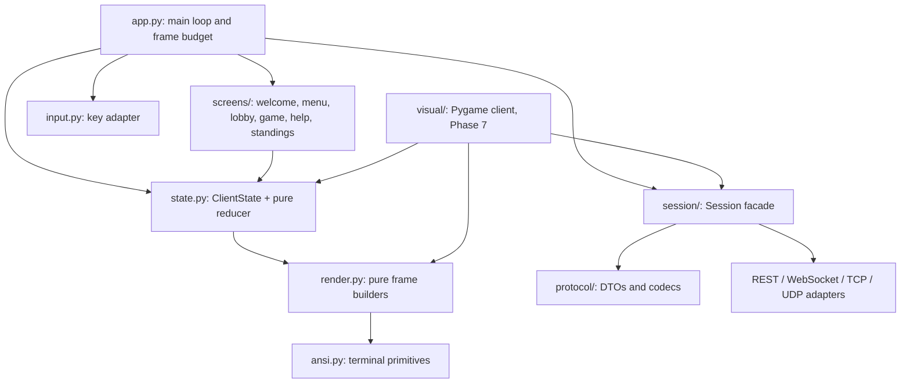
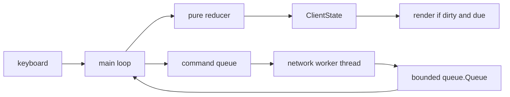

# Client Plan

This document decides **what draws the game** and **how it talks to the
server**. It is intentionally separate from the architecture doc: the rules and
transports stay where they are, while the client grows from a small ANSI shell
into a real-time Pygame view.

The plan covers Phases 0–7. Phases 8–10 add game systems and services; they
extend the clients rather than replace them.

---

## 1. Decision summary

| Concern | Decision | Status |
| --- | --- | --- |
| Primary client, Phases 0–6 | Custom ANSI/raw-terminal client in `client/` | Current prototype is a shell only; see §14 |
| Real-time client, Phase 7 | Pygame client in `client/visual/` | Planned, not started |
| Prototype/reference | Textual app in `client/experiments/textual.py` | Exists; do not extend |
| UI dependency policy | No UI toolkit in the runtime path; Pygame behind an optional extra | `visual = ["pygame>=2.6"]` |

In one sentence: **the terminal client is the product until the game becomes
real-time, and Pygame is the product only for Phase 7's UDP battlefield.**

---

## 2. Why this split

### What the terminal client buys us

- **Control.** Every byte on screen is ours: cursor placement, padding, colour,
  alternate screen and frame diffing. Nothing hides the terminal behind a
  widget layer.
- **Teaching value.** Students meet event loops, non-blocking input, ANSI escape
  sequences, terminal lifecycle, worker threads, bounded queues, frame budgets
  and dirty rendering. Those are the skills the course claims to teach.
- **A small dependency footprint.** Turn-based play needs one key at a time and
  one snapshot at a time. It does not need a UI framework, a browser or a game
  engine.
- **A natural transport seam.** Commands and events are the same whether they
  arrive over REST, WebSockets, TCP or UDP. The UI should not care.

### Honest trade-offs

| Cost | Consequence |
| --- | --- |
| More code to maintain | We own input parsing, resize handling, screen transitions and layout. |
| Terminal edge cases | Windows, `tmux`, `screen`, odd `TERM` values, colour support, Unicode width and fonts all need fallbacks. |
| No widget toolkit | Focus management, scrolling, accessibility and mouse support are manual. Keep the UI keyboard-first and small. |
| Two clients eventually | The terminal and Pygame clients can drift. Share `protocol`, `ClientState` and the reducer; keep a parity smoke test. |
| Pygame is a library, not an engine | It provides windows, input and drawing. The game loop, camera, UI, asset pipeline and netcode are still ours. |
| UDP is genuinely hard | Phase 7 adds loss, reordering, interpolation and reconciliation at the same time. Stage it and keep the terminal client as a reference. |

The terminal client is also the **reference/debug client** even after Pygame
exists. When Pygame reports a correction, the terminal client is the simplest
way to ask whether the server or the visual layer is wrong.

---

## 3. Client layering



| Layer | Responsibility | Must not do |
| --- | --- | --- |
| `session/` | Convert commands/events between the UI and a transport. Own threads and sockets. | Render, decide legality, or expose transport types to the UI. |
| `state.py` | Hold the client view model (`ClientState`) and reduce keys/events into a new state. | Perform I/O, sleep, draw, or mutate server-owned truth. |
| `render.py` | Build a complete frame from `ClientState`, as data (cells, text, styles). | Read the terminal, emit escape codes, send commands, or keep hidden mutable state. |
| `ansi.py` | Escape sequences, cursor movement, colour, alternate screen, size queries. | Know about the game or its screens. |
| `input.py` | Turn terminal bytes into logical keys (`UP`, `ENTER`, `q`, `CTRL_C`). | Change game state or read the network. |
| `app.py` | Own the loop: drain input, drain events, reduce, render, repeat. | Call HTTP/socket APIs directly or block on network I/O. |
| `screens/` | Map `ClientState.screen` to layout and key bindings. | Keep independent booleans or own duplicate state. |
| `visual/` | Pygame loop, interpolation, HUD and debug overlay (Phase 7). | Fork game rules or bypass `Session`. |

The terminal client and Pygame share `state.py`, `session/`, `protocol/` and the
pure frame data from `render.py`. Only `ansi.py`, which serialises frame data
into escape sequences, is terminal-specific.

---

## 4. Event-driven loop design

The loop has one owner and one direction of data flow:

1. The **main thread** owns `ClientState` and calls the renderer. Only the main
   thread mutates client state.
2. A **network worker thread** owns the socket/HTTP connection. It converts wire
   messages into immutable events and pushes them into a **bounded**
   `queue.Queue`.
3. The main loop drains input and the event queue, reduces both into a new
   `ClientState`, and renders only when something changed.



### Loop rules

- **Never block the render loop on HTTP or a socket.** A three-second server
  delay must freeze the status line, not the keyboard.
- **Drain, don't wait.** Each iteration drains all available keys and events;
  the wait for input uses `select` with a short timeout (about 10 ms) so the
  process is idle instead of spinning.
- **Render on dirty or on a cap.** A turn-based screen may change once per
  second; cap terminal rendering at roughly 20–30 FPS, and Pygame at 60 FPS.
- **Timer work uses `time.monotonic()`.** Keep `next_poll`, `next_frame` and
  animation deadlines as monotonic values. Never use wall-clock time for game
  logic and never `sleep(1)` because "one second is one turn".
- **One queue, one consumer.** The worker never touches `ClientState`; the
  renderer never touches the socket.
- **Close in `finally`.** `session.close()` and terminal restoration run on
  normal exit, `Ctrl-C`, and exceptions.

Sketch (terminal phases):

```python
FRAME_INTERVAL = 1 / 20
POLL_INTERVAL = 1.0


def run(session: Session, keys: KeySource, screen: Terminal) -> None:
    state = ClientState.initial()
    dirty = True
    now = time.monotonic()
    next_frame = now
    next_poll = now + POLL_INTERVAL

    try:
        with screen:                      # alt screen + cursor + termios restore
            while state.running:
                changed = False

                for key in keys.poll(timeout=0.01):
                    state = reduce(state, KeyPressed(key))
                    changed = True

                for event in session.drain_events():
                    state = reduce(state, event)
                    changed = True

                now = time.monotonic()
                if now >= next_poll:      # explicit REST polling only
                    session.send(Poll())
                    next_poll = now + POLL_INTERVAL

                dirty = dirty or changed
                if dirty and now >= next_frame:
                    screen.draw(render(state))
                    dirty = False
                    next_frame = now + FRAME_INTERVAL
    finally:
        session.close()
```

`Poll()` is a client-local command for the REST adapter. WebSocket, TCP and UDP
adapters push events themselves, so the polling branch disappears there. The
UI does not need to know which is true.

---

## 5. The transport seam: a synchronous `Session`

The UI-facing seam is deliberately **synchronous** and free of `async`/`await`:

```python
class Session(Protocol):
    def send(self, command: Command) -> Ack: ...
    def drain_events(self) -> list[Event]: ...
    def close(self) -> None: ...


@dataclass(frozen=True)
class Ack:
    command_id: str
    status: Literal["queued", "accepted", "rejected"]
```

Synchronous signatures stop async colouring every screen and test. But
`synchronous` must not mean `blocking on the render thread`:

- `send()` **enqueues** the command for the adapter's worker and returns
  immediately with `Ack(status="queued", command_id=...)`.
- The authoritative result arrives later as a `CommandAccepted` or
  `CommandRejected` event through `drain_events()`.
- `drain_events()` returns everything collected since the last call and never
  performs I/O.
- `close()` is idempotent and safe to call from `finally`.

Adapters own the blocking work internally:

| Adapter | Phase | How it avoids blocking the UI |
| --- | --- | --- |
| `HotseatSession` | 0 | Calls `apply_action` directly; no threads. |
| `RestSession` | 1–3 | Worker thread runs `httpx`; polling timer requests state. |
| `WebSocketSession` | 4–5 | Reader thread; reconnect/backoff lives inside the adapter. |
| `TcpSession` | 6 | Reader thread parses frames; writer queue serialises commands. |
| `UdpSession` | 7 | Reader thread for snapshots and acks; send loop for commands. |

The UI imports `session.base` (the protocol) and a factory such as
`make_session(config)`. It must not import `httpx`, `websockets`, `socket`,
`asyncio` or `pygame`.

### Queue policy

- Use a bounded queue (for example `maxsize=256`).
- Never drop commands or errors silently.
- Under pressure, coalesce or drop **state snapshots**, set a `resync_needed`
  flag, and request a keyframe on the next send.
- Log queue depth; it is a useful debug-overlay metric in Phase 7.

---

## 6. Naming and state

The client-side `GameState` class in `client/state.py` is **not** the
authoritative game state. Rename it to **`ClientState`**:

```python
@dataclass(frozen=True)
class ClientState:
    screen: Screen              # WELCOME | MENU | LOBBY | GAME | HELP | STANDINGS
    connection: ConnectionState
    player_id: str | None
    game_id: str | None
    snapshot: Snapshot | None   # server view, already fog-filtered
    selected: tuple[int, int] | None
    command_buffer: str
    status: str
    last_error: str | None
    pending: tuple[str, ...]    # command ids
    running: bool = True
```

- **`ClientState` is a view model.** It contains what the screen needs, not what
  the server needs. Do not reuse `core.GameState` even when the fields look
  similar.
- **One reducer.** `reduce(state, event_or_key) -> ClientState` is pure and
  testable. No screen builds its own mini-state.
- **Screens are a state machine.** A single `Screen` enum replaces
  `welcome_screen`, `main_menu`, `playing` and their impossible combinations.
  Transitions are explicit: `MENU --create--> LOBBY --start--> GAME`.
- **Events are immutable.** Use frozen dataclasses for `Event`, `Command` and
  `Ack`. The network thread may only enqueue them; it never mutates a shared
  object.
- **Do not keep a mutable snapshot shared with the worker.** The worker sends a
  fresh immutable object; the reducer replaces the old one.

---

## 7. Terminal concerns

| Concern | Rule |
| --- | --- |
| Platform | Target POSIX (`termios`, `tty`) first: Linux and macOS. Document that Windows needs WSL, ConPTY or a separate `msvcrt` input backend. |
| Mode | Use `tty.setcbreak()` for key-at-a-time input without losing `Ctrl-C`, or `tty.setraw()` if you handle `Ctrl-C` and `\r\n` yourself. Pick one and write it down. |
| Restore | Save attributes before changing them; restore in `finally`; install `SIGINT`/`SIGTERM` handlers that raise so `finally` runs. `SIGKILL` cannot be caught — accept that. |
| Alternate screen | Enter `\x1b[?1049h`, leave `\x1b[?1049l`; hide/show the cursor with `\x1b[?25l` / `\x1b[?25h`. |
| Flicker | Prefer **home-and-pad**: move to `\x1b[H`, write each line padded to terminal width, then erase to end (`\x1b[J`). Use full clear (`\x1b[2J`) only on screen changes or resize. Never clear *after* drawing. |
| Minimum size | Define a minimum (for example 80 × 24). If smaller, draw a centered "resize to at least …" message instead of a broken board. |
| Resize | Handle `SIGWINCH` by setting a flag and re-querying `shutil.get_terminal_size()`; do not rebuild layout inside the signal handler. |
| Unicode and ASCII | Detect encoding (`sys.stdout.encoding`) and offer an ASCII frame (`.`, `#`, `@`) when UTF-8 is unavailable. |
| Colour | Respect `NO_COLOR` and `TERM=dumb`; degrade to 8 colours, then none. Never rely on colour alone to distinguish players. |
| Escape sequences | Parse incrementally. `ESC` alone is a valid key; `\x1b[A` is an arrow. Use a short timeout and do not swallow the following keystroke. |
| Output | Build one string per frame, write once, flush once. In raw mode emit `\r\n`, not bare `\n`. |
| Logging | Never `print()` debug output into the UI. Log to a file or a separate pane. |

Recommended minimum checks before calling the terminal work done:

- launch, play, `Ctrl-C`, and confirm the prompt looks normal;
- resize while running and after returning from `vim`/`less`;
- run inside `tmux` and `screen`;
- run with `TERM=dumb` and with `NO_COLOR=1`;
- pipe stdout to a file and confirm the app refuses to start or falls back to
  line mode instead of emitting control codes into the file.

---

## 8. Pygame plan (Phase 7)

Pygame is an SDL binding: it gives us a window, input events, surfaces, fonts
and a clock. It is **not** a full engine. The game loop, UI layout, camera,
asset pipeline, netcode and debug tooling are still ours.

### Shape

| Module | Responsibility |
| --- | --- |
| `visual/app.py` | 60 FPS loop, snapshot buffer, interpolation, input dispatch. |
| `visual/view.py` | Tile grid, HUD, event log, selection highlight, camera. |
| `visual/input.py` | Keyboard and mouse mapping to commands. |
| `visual/interp.py` | Two-snapshot buffer and alpha calculation. |
| `visual/overlay.py` | Debug overlay and counters. |
| `visual/net.py` | Worker thread + queue around the shared `Session`. |

### Loop and rendering

- **60 FPS render loop.** Call `clock.tick(60)`; never spin.
- **10 Hz snapshots** arrive over UDP. Keep the last two authoritative
  snapshots with server timestamps and render between them with
  `alpha = (now - t0) / (t1 - t0)`.
- **Shared logic:** `ClientState`, the reducer, `render.py`'s pure frame data,
  `protocol` and `Session` are shared with the terminal client. Pygame only
  replaces the output layer.
- **Interpolation buffer** holds two snapshots; a late snapshot is dropped, a
  missing one is filled by extrapolating no more than one tick and then holding.
- **Prediction/reconciliation only in Phase 7.** Predict the local player's
  movement/appearance optimistically, tag it with the command sequence, and
  reconcile against the next authoritative snapshot. Roll back visibly and
  count corrections.
- **No network calls on the render thread.** The worker thread owns
  `UdpSession`; the main thread drains `session.drain_events()`.
- **Cache surfaces.** Pre-render fonts, tile glyphs and player colours; do not
  rebuild them every frame.
- **Frame budget:** 16.6 ms. Spend it on drawing, not JSON parsing or sockets.

### Screen contents

- Tile grid with terrain glyphs, ownership colour and strength numbers.
- HUD: round/tick, AP, resources, territory percentage, connection state.
- Event log: last N domain events, scrollable with the keyboard.
- Selection: mouse click or keyboard cursor; selected tile gets a bright border
  and a side panel with legal-looking actions.
- Debug overlay (toggle with `F1`): FPS, snapshot tick/version, queue depth,
  RTT, estimated loss, corrections, pending commands, last server error.

### Testing

The visual client must be testable headlessly:

```bash
SDL_VIDEODRIVER=dummy SDL_AUDIODRIVER=dummy pytest -m visual
```

Expose functions that take a surface and a state; tests call them without
opening a window. Keep event-loop code thin so most logic lives in pure
functions.

---

## 9. Testing strategy

| Layer | How | What it proves |
| --- | --- | --- |
| Reducer | Feed synthetic `Event`/`KeyPressed` sequences to `reduce` | Every screen transition and command mapping; no I/O |
| Renderer | Golden frame fixtures: `render(state) == fixture`, plus `ansi.render(frame)` strings | Layout is stable and testable without a terminal |
| `Session` seam | A scripted `FakeSession` implementing the protocol | Screens never import transports; errors are shown, not raised |
| Input parsing | Byte strings (`b"\x1b[A"`, `b"q"`, lone `b"\x1b"`) | Escape sequences and partial reads are handled |
| Terminal lifecycle | Optional PTY test or a manual checklist | Alternate screen and termios are restored |
| Pygame | `SDL_VIDEODRIVER=dummy`; call draw/update functions | Interpolation, overlay counters and layout logic |
| Parity | Same event script through terminal and Pygame reducers | The two clients do not diverge |

Rules:

- Unit tests never open a real terminal or window.
- Do not mock `sys.stdin`; pass a key source into the loop.
- Do not assert on timing; inject a monotonic clock or step the loop manually.
- Mark visual/slow tests so `pytest -m "not visual"` stays fast.

---

## 10. Packaging

Pygame is optional and belongs to Phase 7:

| Extra | Installs | Used in |
| --- | --- | --- |
| `visual` | `pygame>=2.6` | Phase 7 Pygame client |
| `full` | everything above plus the existing course extras | convenience install |

```toml
[project.optional-dependencies]
visual = ["pygame>=2.6"]
```

The terminal client must never import `pygame`. Import it lazily inside
`client/visual/` (or at module import in `visual/app.py`, which is only loaded
for that client), so a base install still runs Phases 0–6.

**Textual** remains only for the prototype in `client/experiments/`. It is not
part of the terminal client's runtime path. If the base dependency list is
trimmed, move Textual to a `prototype` extra or remove it together with the
experiment and its tests; do not let it creep back into `client/`.

---

## 11. Milestones C0–C6

Client work is tracked separately from server phases so a client milestone can
land against a stub server or a fake `Session`.

| Milestone | Build | Definition of done |
| --- | --- | --- |
| **C0 — Terminal shell** | `app.py` loop, `screens/` state machine, `input.py`, alternate screen, size check, restore, resize flag. | Welcome → menu → game → help → standings can be navigated; `Ctrl-C` and normal quit restore the terminal; resize does not crash; no networking. |
| **C1 — Renderer and state** | `ansi.py`, pure `render.py`, `ClientState`, pure reducer, golden frames; remove the `GameState` booleans. | Same state produces byte-identical frames; renderer has no I/O; reducer tests cover each screen transition; `ClientState` is immutable; golden frames are committed. |
| **C2 — REST session and polling** | `session/base.py`, `RestSession`, factory, 1-second `Poll`, command queue, error events. | Two terminal clients finish a scripted game against the Phase 1 server; UI stays responsive during an artificial 3-second delay; only `session/` imports HTTP; terminal restores on errors. |
| **C3 — Auth, fog and standings** | Token handling, fog-filtered snapshots, standings/help screens, `401/403/409` display. | Two clients see different maps; a rejected action shows a stable error code; standings match the server; no client-side fog filtering. |
| **C4 — Push updates** | Network worker thread, bounded `queue.Queue`, reducer wiring, reconnect with `since_version`, overflow/resync policy. | A move appears without a keypress; killing the server connection reconnects and converges; 20 rounds with random disconnects show no divergence; queue depth never grows without bound. |
| **C5 — TCP transport** | `TcpSession` with length-prefixed frames, reader thread, writer queue, `--transport` switch. | A full game over TCP with the same terminal UI; partial headers and two frames in one read are tested; shutdown is clean; no rules duplicated in the client. |
| **C6 — Pygame UDP client** | `visual/` loop, 60 FPS render, 10 Hz snapshots, interpolation buffer, prediction/reconciliation, debug overlay, headless tests. | A 5-minute match survives 10% loss and 50 ms jitter; the overlay reports corrections trending to zero; a 2-second blackout recovers; `SDL_VIDEODRIVER=dummy` tests pass; the terminal client still plays Phase 6. |

Milestones are cumulative. C6 does not remove C5; the terminal client remains
the reference client.

---

## 12. Milestones to phases

| Phase | Client milestone | Notes |
| --- | --- | --- |
| 0 — Rules engine and hot-seat | C0, C1 | A local shell and pure renderer; hot-seat uses `apply_action` directly. |
| 1 — REST API | C2 | Terminal client + 1-second polling over REST. |
| 2 — Persistence | — | Server-only. Manually verify the client reconnects after a restart. |
| 3 — Auth, authority, fog | C3 | Tokens, visibility, standings, error display. |
| 4 — Real-time updates | C4 | Worker thread, bounded queue, WebSocket, reconnect. |
| 5 — Alliances | C3/C4 extension | Diplomacy screens reuse the lobby/game layout; no new transport. |
| 6 — TCP rewrite | C5 | Same UI, different `Session` adapter. |
| 7 — UDP battlefield | C6 | Pygame client only; terminal client remains the debug/reference path. |
| 8–10 — Economy, bots, distributed | C4/C6 extension | HUD additions; bots use `protocol`, not the UI. |

Phase 2 deliberately has no client milestone. If the client needs work to
survive a restart, that is a bug in the Phase 1 connection handling, not a new
feature.

---

## 13. Risks and mitigations

| Risk | Why it matters | Mitigation |
| --- | --- | --- |
| Terminal portability | Windows and unusual `TERM`/`tmux` setups break raw mode, colour or resize. | POSIX first, documented Windows path, ASCII/colour fallbacks, manual checklist in CI docs. |
| Renderer scope creep | A "small" renderer grows into a widget toolkit and stalls the course. | Pure frame builders, no layout framework, shared helpers only, timebox each screen. |
| Two clients diverge | Pygame and terminal interpret events differently. | Shared `ClientState` reducer and `protocol`; parity smoke test; terminal client is the reference. |
| Pygame polish | Art, animation and UI absorb time that belongs to netcode. | Placeholder shapes until Phase 7 works; timebox visuals; one debug overlay. |
| UDP complexity | Loss, reordering and prediction are hard to debug in a GUI. | Keep the terminal client as a headless reference; test through the chaos proxy; add the overlay before polish. |
| Thread and queue bugs | Shared mutable state causes nondeterministic corruption. | Immutable events, single owner of state, bounded queue, queue-depth metric. |
| Blocking calls leak into the UI | One slow request freezes input and hides bugs. | `Session` facade plus a lint/review rule: no transport imports outside `session/`. |
| Terminal left broken on crash | A traceback in raw mode leaves the user stuck. | `try/finally`, signal handlers that raise, a `reset` note in the help screen. |

The standing rule: **when the two clients disagree, the server and the terminal
client are the source of truth; Pygame is the suspect.**

---

## 14. Current prototype status

This is a starting point, not the target. None of the networking, rules engine
or Pygame work exists yet.

| File | What exists today | Gap to the plan |
| --- | --- | --- |
| `client/main.py` | 10 FPS `sleep(0.1)` loop, welcome/menu/grid, `GameState` booleans. | C0: replace with state machine, dirty rendering and terminal lifecycle. |
| `client/input.py` | Module-level `termios` save, `tty.setcbreak`, non-blocking `select`, arrow-key mapping. | C0: key adapter with restore context manager, resize, and no import-time side effects. |
| `client/draw.py` | `print`-based screens; `draw_grid` prints one cell per line; `clear()` does home + full erase. | C1: pure `render.py` returning a frame string; `ansi.py` primitives; padded diff rendering. |
| `client/state.py` | Mutable `GameState` with `welcome_screen`, `main_menu`, `playing` and a placeholder grid. | C1: immutable `ClientState` + reducer; screens as an enum. |
| `client/experiments/raw.py` | Raw-mode reference loop with alternate screen, cursor hide/show and `finally` restore. | Reuse its lifecycle lessons in C0; it still blocks on `sys.stdin.read(1)`. |
| `client/experiments/textual.py` | Minimal Textual grid/button prototype. | Keep as reference only; do not extend it. |
| `tests/experiments/test_grid_app.py` | Tests the Textual prototype. | Keep green while the prototype exists; move or delete with it if Textual becomes optional. |
| `client/session/` | Does not exist. | C2: `Session` protocol, factory and `RestSession`. |
| `client/visual/` | Does not exist. | C6: Pygame loop, interpolation and overlay. |

There is **no rules engine and no working server** behind the shell yet; the
grid is a placeholder. The prototype proves the terminal lifecycle and the
10 FPS loop, nothing more.
