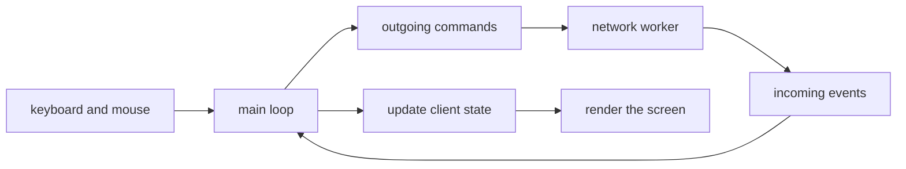

# Client Plan

This document decides what draws the game and how it talks to the server. It
assumes the rules in [01-game-mechanics.md](01-game-mechanics.md) and the phase
order in [02-development-phases.md](02-development-phases.md).

## Decision

**Use a custom ANSI terminal client for Phases 0–6, and Pygame only for Phase 7's
real-time UDP mode. Textual is not part of the plan.**

| Concern | Decision |
| --- | --- |
| Turn-based play, Phases 0–6 | Custom ANSI terminal client |
| Real-time battlefield, Phase 7 | Pygame |
| Textual | Not part of the plan |
| Reference and debug client, always | Terminal |

## Why this split

- **Control and learning value.** Every character on screen is deliberate:
  layout, cursor placement, colour, redraw. Nothing is hidden behind a widget
  layer, so the loop and the state are visible.
- **A small dependency footprint.** Turn-based play needs one key at a time and
  one snapshot at a time. It does not need a UI framework or a game engine.
- **An honest seam.** Commands go out and events come in whether the transport
  is REST, WebSockets, TCP, or UDP. The interface should not care which.

The trade-offs are real:

| Cost | What it means |
| --- | --- |
| More terminal code | Input parsing, resizing, layout, and screen transitions are yours. |
| Portability | POSIX first; Windows and exotic terminals need a documented path and fallbacks. |
| Two clients | The terminal and Pygame can drift, so they must share state and protocol. |
| Pygame is a library | It gives a window, input, and drawing; the loop, UI, and netcode are still yours. |
| UDP is hard | Loss, reordering, interpolation, and prediction arrive together. |

## Design constraints

- **The server is authoritative.** The client never decides whether an action is
  legal, and it never filters fog. It renders what it is given and shows errors.
- **Client state is separate from game state.** Cursor, selection, screen,
  command buffer, and status belong to the client. The game state belongs to the
  server.
- **The transport is a seam.** Commands go out; events come in. The UI does not
  know whether it is talking REST, WebSockets, TCP, or UDP.
- **The loop is event-driven.** Input events and network events update client
  state, and the screen renders from that state. No network call blocks the
  render loop.
- **The terminal lifecycle is explicit.** Enter and leave the alternate screen,
  use raw or cbreak mode deliberately, restore on every exit path, handle
  resize and a minimum size, and fall back from Unicode or colour when needed.

## Phase mapping

| Phase | Client |
| --- | --- |
| 0 | Terminal hot-seat game |
| 1 | Terminal client over REST |
| 2 | No client change; it must survive a server restart |
| 3 | Fog-aware views and clear authorization errors |
| 4 | Live updates without polling |
| 5 | Diplomacy screens reusing the game layout |
| 6 | The same terminal client over TCP |
| 7 | Pygame for real-time UDP; terminal remains the reference |
| 8–10 | HUD and screens extend; bots use the protocol, not the UI |

## Pygame scope

Pygame appears only when the game becomes real-time. It provides a window,
input, and drawing, not a game engine: the game loop, camera, UI, assets, and
netcode are still ours.

- Render at 60 FPS from 10 Hz authoritative snapshots.
- Interpolate between the last two snapshots for rendering; keep prediction
  explicit and reconcilable.
- Use prediction and reconciliation only in Phase 7, and make corrections
  visible.
- Keep a debug overlay: tick, estimated loss, corrections, pending commands, and
  frame rate.
- Share the protocol and client state with the terminal client, and keep drawing
  testable without opening a window.
- Treat the terminal client as the tie-breaker when the two clients disagree.

## What I will not do

- No client-owned game state or movement; the cursor is UI only.
- No client-side legality checks.
- No client-side fog filtering.
- No UI toolkit inside the core rules.
- No styling before the loop, state, and protocol are honest.

## The loop

One owner of client state, one direction of data flow, and no blocking calls
between input and drawing.
